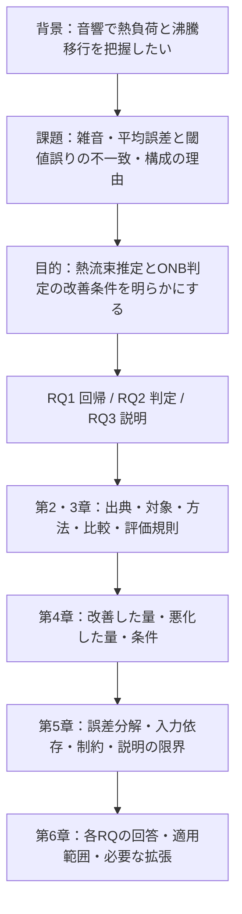

# 修士研究の目的・問い・成果・限界の再検討と、修論完成までの方針

2026-10-21。本人の今回の依頼に基づく**新しい判断案**。過去の研究履歴を訂正して消すものでも、教授了承済みの方針でもない。現LaTeXを正しい前提にせず、原計画・教授メモ・実装・保存結果と照合した。研究対象・ラベル・通常設定・修論本文は変更していない。

**最も妥当なのは、熱流束全域の推定精度とONB判定を二つの主要な性能課題に置き、統合による改善の成立範囲と理由を説明する論文である。** 全域RMSE低減は主要成果であり、ONB検知への単なる補助へ格下げしない。同時に、総FN減少を開始段階の十分な検知へ読み替えない。現成果から「研究全体が未達」と総括することも、「雑音下の早期検知を確立」と総括することも適切ではない。

| 今回の主要判断 | 判断の根拠 | 次の扱い |
|---|---|---|
| 目的は案Bを上位に、案Cを解決の筋として組み込む | 原計画に熱流束推定・判定・説明の全てがあり、主系列で回帰と判定の双方に実測の利得がある | 研究目的とRQを教授へ相談。年度計画との違いを隠さない |
| RQ1＝全域回帰、RQ2＝ONB判定、RQ3＝改善・悪化の説明 | 二つの出力評価と、その差の説明という分担。雑音は全RQに共通する条件 | 第1・3・4・5・6章の対応を固定する |
| 10/15主系列で全7条件の全域RMSE・総FN改善は確実 | 元3 MSEとの同じ540区間の比較を、今回も原予測から照合 | 第4章と第6章で主要成果として明記 |
| −20 dBの開始層は現重み制約の変更可能範囲外 | 30見逃し全てで、元3内部比率固定・ブロック下限下の1標本別最大予測も閾値未満 | ONB目的の重み変更に過大な期待を置かない |
| 最初に必要なのは出典・正解根拠と論理の整備 | モデル追加でデータ取得者・ONB観察根拠は補えない。既存の分析は多くが完了 | 確認依頼と執筆を並行。CNNは保存済み探索を維持 |

主たる根拠は[10/15主系列][main]、[原計画・発表の今回抽出][extracts]、[教授原メモ][prof]、[今回の検算][audit]。研究活動の個別対応は[証拠台帳][inventory]にまとめた。

## 調査時点と証拠の扱い

### Git・進行中作業・草稿

- 開始時のブランチは`main`、HEADは`259bd4b8c86669e92a4292f064270b6881b99b65`。`git status --porcelain=v1`は空。remoteは`S-Riku-tus/university_research`。fetch・checkout・commit・pushは行っていない。
- [research_status.md](../research_status.md)の冒頭には**コミット済みの競合マーカー**があり、10/20の「CNN未起動」と10/21の停止・再開準備記録が併存する。作業ツリーの未解決マージではない。本調査では修復せず、実ファイルを優先した。過去の未起動・未実装記述は履歴である。
- CNNは実装・探索開始・停止・再開準備を経て、**実際の再開先に新しい完了候補が存在する**。17:27 JSTの[保存監査][audit]では、重複を除く完了数はAlexNet36、ResNet50 24、VGG16 0。停止記録のResNet50 23より1候補進んでいる。再開先にはAlex採用1＋ResNet24＝25監査ファイルがある。元59件のhashは全て不変。稼働・停止状態は推測せず、完了保存分だけを数えた。
- [現LaTeX](../../LaTeX/master_thesis/main.tex)は6章・要旨・付録を持つ試作。緒言の目的はONB開始近傍へ強く寄り、第6章は全域改善を「部分的改良」と総括している。今回の再検討は、この重心を見直す提案であり、草稿の存在を方針確定の根拠にしていない。[草稿の位置づけ][draft]、[前の章論理検討][old-logic]、[12月末計画][schedule]も参照した。

### 実験系列を混ぜないための境界

| 系列 | 条件と役割 | 今回の利用範囲 |
|---|---|---|
| **主性能** | 10/15 `143609`、hash `da540f2d`、clean fit `7560205f8feb`。6/11＋6/18、36 WAV、1秒・3 kHz、1620学習/540評価、各45/15、split42、内部shuffle chunk3-fold、seed42、200 epochs、選別なし、clean_only、7評価雑音 | 主結論の数値。原CSV・重み・OOF・manifestを照合 |
| 誤差接続 | 10/14分析の元runは`193305`。同条件の先行200 epochs系列 | 分解・説明の根拠。今回10/15にも同方向群の値が保存されていることを確認。独立反復とは数えない |
| 入力・配分対照 | 10/7第1–3段階。保存モデル加工、内部比率自由化、特徴除去再学習等 | 実施済みの別対照。10/15に新しく加工・再学習したとは書かない |
| 選択・補助 | 9月の別日/WAV分離、150 epochs、3/22 kHz、matched、追加seed43/44、追加候補 | 採用理由・限界の証拠。主系列の「3 seed再現」や最新5 matchedの結果へ合算しない |
| 現在のCNN3 | 同じ外側分割・clean学習側OOF、200 epochs。構成はAlex/ResNet/VGG | 探索中。外側性能はまだ結論に用いない |
| その他 | 7/9、2026/10/7、2024年生成、旧生成・legacy重み | 過去活動は棚卸しするが、本人が対象外としたrunの再解析・主比較への追加はしない |

出典：[主条件][conditions]、[入力対照][inputs]、[接続分析][linkage]、[CNN再開履歴][cnn]。本調査で行った数値処理は保存表・予測の軽量な検算と診断に限る。

## 第1部　本人の意見をどう受け止め、どこを修正するか

| 本人の意見・論点 | 妥当な部分 | 修正・留保が必要な部分 | 今回の結論 |
|---|---|---|---|
| 全域RMSE改善には独立した価値がある | 連続的な熱流束推定は、状態把握に関する定量課題。元3比の全7条件改善は主要な到達点 | 全域は**評価標本分布上の平均二乗誤差**。全ての熱流束領域・各区間で良くなったことではない | 主要目標・RQ1に明示する |
| 開始段階の未達だけで研究全体を評価しない | 回帰、総FN、一部q100、説明・制約の知見は実在する | 年度計画の早期検知・物理対応への不足は消せない | 成果の成立と応用目標への距離を別に総括する |
| 雑音時の絶対誤差改善も価値がある | 固定cleanモデルへ未知の付加負荷を与える比較で、誤差が低いこと自体に価値がある | 「劣化量抑制」「一般的雑音耐性」と同義ではない | 「対象の全6付加雑音条件で元3より低RMSE」が基本表現 |
| 結果の悪い指標を目的から外したくない | 科学的に必要。ONBは独立に評価し続ける | 全域RMSEだけを目的にして当初の近傍・判定目標を消す案は採らない | 二つの性能課題を併置する |
| ONB30区間は少ない | 独立した原録音は2本しかない。一般化の根拠は弱い | 「30に設定した」「30回の独立ONB」「7雑音で210事例」は誤り | 標本数・録音数・日数を並記する |
| CNNも調整して比較する | 未調整による不利を避ける意味がある | 候補数・内部分割・選択基準・開発履歴の差は残る | 調整済み構成の開発比較として扱う |
| 説明性を研究全体へ接続する | 性能差の説明に必要。共通加工・除去再学習まで完了している | 帰属量の直接比較や、時間依存差から雑音利得への因果断定はできない | 誤差分解→入力依存→物理仮説の順に証拠を分ける |
| 原データ確認は何が必要か具体化する | 主2日の取得・ラベル根拠が最優先 | 7/9も基準RMSに使われる。出典確認は主学習データだけに閉じない | 第7部に質問先・資料・終了条件を指定する |

以前の[10/19目的整理][old-purpose]にある「全域回帰は主に基礎性能」「第4章は開始段階を重視」という重心は、今回の意向と主結果を踏まえ改める。一方、そこで整理した指標の区別、原ONB根拠の未確認、物理因果の留保は維持する。

## 第2部　研究目的の再構築

### 2.1 原計画と教授の指摘が要求していること

[研究計画原本][original-plan]は、熱流束推定とONB近傍検知への利用、単体・統合比較、特徴の物理的妥当性を含む。[年度研究指導計画書][annual-original]は、とくに開始点近傍の早期検知と物理現象への対応を強く掲げている。5/22・7/24原スライドにもその目標がある。ただし、候補手法の全実施や全目標達成を要求する結果記録ではない。[原本抽出][extracts]

10/16教授メモは「予測誤差で見るのは良いが，目的から考えてやりたい」「流れを整理」「理由とかロジック」を要求している。**教授が全域RMSEの主要成果化を否定したという証拠はない。** 反対に、ONBを目的から外す了承も記録されていない。6/12相談後の整理・6/19方針は、本人の記録と解釈を含み、全てを教授の逐語発言にしない。[教授原文][prof]、[6/12整理][june-plan]

### 2.2 目的案の比較

| 案 | 原計画・教授指摘との整合 | 現成果をどう扱えるか | 独自性・研究としての注意 | 残り期間との整合 | 判断 |
|---|---|---|---|---|---|
| A：早期ONBを最上位、全域回帰は基礎 | 年度計画の重点を最も直接継承 | 全域・総FNの成果はあるが、開始層の弱さが総括を支配しやすい | 真の発生時刻の正解がなく、早期検知の意味が熱流束段階に限られる | 高い開始検知・時間遅延まで達成条件にすると新観測が必要 | 応用上の目標として残す。修士全体の単一達成軸にはしない |
| B：雑音下の熱流束推定とONB判定の双方を改善 | 原計画の連続量推定と判定を明示的に分担。早期近傍も維持可能 | 全域回帰と判定の利得・残存課題を同じ重さで記述できる | 単なる多指標測定にせず、なぜ同じ出力を二面から評価するかを説明する | 保存結果で中心回答が成立し、必要補強を限定できる | **目的の推奨軸** |
| C：モデル統合の改善条件と限界を中心 | 教授の「なぜ・ロジック」に合う | 誤差補完、制約、入力依存、否定結果が明確な知見になる | 手法比較自体が目的となり、何の工学課題を解くかが弱くなる危険。統合の発想自体を新規性としない | 多くの証拠が既存。説明・考察中心に収束できる | Bを解くための研究の筋として採用 |
| D：水の沸騰状態の定量把握を上位にし、回帰と判定を置く | 工学的には自然 | ONBだけでなく広いq範囲の意味が明確 | 「沸騰状態」全般、流動様式・気泡数・実機状態まで広げるとデータを越える | 対象をqと既知閾値判定に限定すれば可能 | Bの背景の説明に利用。新しい対象量は増やさない |

推奨は**B＋C**である。成功した指標だけを残す変更ではない。全域回帰という元から存在した課題を独立に明示し、当初のONB・近傍課題も回答対象に保持する変更である。年度計画の重点を相対化する実質的な見直しである以上、教授に「同じ目的の言い換えだけ」と説明せず、成果と未達を見せて相談する。

### 2.3 第1章へ記載できる目的文案

> 沸騰を伴う熱流動系の音響監視では、沸騰への移行を判定するとともに、熱負荷の変化を定量的に把握することが課題となる。本研究では、その基礎的検討として既存の水のプール沸騰音響データを対象に、背景水流音下での熱流束推定誤差と、予測熱流束に基づく沸騰開始判定の見逃し・誤報を低減するためのモデル構成および統合条件を明らかにすることを目的とする。
>
> このため、入力表現および学習方式の異なる回帰モデルを比較・統合し、広い測定熱流束範囲における回帰性能と、日別の記録上ONB熱流束を基準とした判定性能を区別して検証する。判定では全評価区間の見逃し・誤報に加え、開始段階とその近傍を評価し、全域回帰の改善がどの範囲で判定の改善につながるかを明らかにする。さらに、モデル間の予測誤差の関係と入力特徴への依存を分析し、改善と悪化の理由、適用範囲および残る課題を説明する。

この前段に、ナトリウム冷却高速炉等で冷却材沸騰を早期に把握したいという**応用上の意義**を置ける。ただし本目的の実証対象は、水・既存録音・付加水流音・既知日別ONBである。実機の検出確率、事故防止性能、警報時間、未知条件のONB値推定は本研究が直接検証する範囲に入れない。熱流束推定も録音段階のラベル推定であり、瞬時熱計測の代替を実証したわけではない。

### 2.4 論文の貢献の置き方

1. 同一評価標本・固定cleanモデルの条件で、異なる表現・学習器の統合が、全域回帰と閾値判定のどちらを改善するかを定量的に示す。
2. 全域・領域別・開始段階・q100を対応づけ、集約誤差の改善と境界判定の限界が両立することを示す。
3. 予測の代数的分解と共通入力対照・除去再学習により、有用な補完が逆符号相殺だけではなく同方向誤差縮小を含むこと、入力依存差だけでは物理因果が確定しないことを示す。

これは既存手法を使った応用上・評価上の知見である。新規な汎用アンサンブルアルゴリズム、世界初の音響回帰、物理音源の同定としては主張しない。先行研究との差の確定には[草稿のL01–L02][draft]の本文照合が必要であり、資料調査なしに新規性を確定しない。

## 第3部　研究上の問いを目的から導く

### 3.1 なぜ三つに分けるか

目的には「連続量の推定」「閾値による判定」という異なる誤りの定義があり、さらに教授が求める「差を説明する」課題がある。このため三つが扱いやすい。三という数に必然性があるわけではない。二つにすると説明が性能評価に埋もれ、四つ目として雑音を分離すると、同じ条件因子を回帰・判定で重複して問うことになる。

したがって、以前のONB中心の三問をそのまま継承せず、以下に置き直す。雑音・モデル構成はRQ1/2の共通の比較軸であり、説明性は全モデルの地図を揃える義務ではない。

### 3.2 RQ1：全域回帰

**問い：異なる入力表現・学習方式のモデルの統合は、対象の測定熱流束範囲と付加水流音条件において、単体・基準構成に比べて熱流束推定誤差をどこまで低減するか。**

| 必須要素 | 定義・現在の判断 |
|---|---|
| 設定理由 | 状態把握の基礎となる連続量を小さい誤差で推定したい。ONB判定を経由せず成立する目的上の課題 |
| 回答したと判断する条件 | 比較相手・評価範囲を固定し、全域誤差の差、改善しない条件・領域、雑音時絶対性能と劣化の違いを示せる。全条件最良や有意差を成立条件にはしない |
| 評価方法 | 主5単体、元3performance/MSE、HGB4、ET4、5MSE、5等重み。同じ540区間・7条件。主指標RMSE、補助MAE/R²、領域/日別誤差。OOFは選択・重みfit、外側は記述比較 |
| 既存の証拠 | [主表][metrics]、[比較相手別差][baseline-deltas]、[領域別表][regions]、[劣化量][degradation]、[今回再集計][recomputed] |
| 現在の回答 | 元3 MSEに対し全7条件RMSE低減。clean34.07→27.80、−20で81.14→75.23。各領域/単体/4構成に一律優位ではない。元3 MSE比の劣化量抑制は支持されない |
| 未回答 | 現5の未知WAV/未知日、独立雑音、主200 epochs系列の複数独立反復、CNN3の外側成績、全モデル構成の最適性 |
| 追加の要否 | 現範囲の回答は既存証拠で成立。CNNは構成対照の補強。一般化を主張する場合のみ新評価が必要 |
| 論文配置 | 1.3で定義→3.3/3.4/3.5で設計→4.1–4.3で結果→5.1/5.2/5.5で理由・範囲→6.1で回答 |

### 3.3 RQ2：ONB判定

**問い：同じ回帰予測の統合は、既知の日別ONB熱流束に基づく見逃し・誤報をどう変え、その改善は記録上の開始段階と検知到達熱流束まで及ぶか。**

| 必須要素 | 定義・現在の判断 |
|---|---|
| 設定理由 | 小さい平均回帰誤差だけでは、閾値のどちら側に予測が出るかを保証できない。ONBへの応用を研究対象に残すための独立課題 |
| 回答したと判断する条件 | 総FN/FPと母数、開始層・近傍、日別q100を併記し、訂正と新規誤りを示す。実用上十分な率をAIが設定しない。時刻正解がない場合は早期時刻検知の回答をしない |
| 評価方法 | 同じ構成・540区間・7条件。日別閾値で真値/予測とも`>=`を陽性。陽性315/陰性225。近傍±10%、開始層30。Recall・Precision/FPR、q100を分担 |
| 既存の証拠 | [主判定表][metrics]、[開始層][onset]、[日別q100][q100]、[失敗例][failures]、[今回の区間照合][partition] |
| 現在の回答 | 元3 MSE比で総FNは全7条件減少、FPは同数。開始層はclean3/30→8/30等の限定改善があるが、−20は両者0/30。6/18 clean q100は434.02→376.32、6/11は不変 |
| 未回答 | 真の気泡発生秒の検出、未知日のONB閾値の取得、許容誤報/見逃しに対する十分性、多数独立ONB事例での再現性 |
| 追加の要否 | 現在の判定評価は不可欠で、既に可能・実施済み。30を恣意的に増やす実験は不要。ONB目的の重み比較は、改善可能性を限定して採否判断 |
| 論文配置 | 1.3→2.2/3.5→4.4/4.5→5.1/5.2/5.5→6.1。全域回帰と別の回答文を置く |

### 3.4 RQ3：改善・悪化の理由

**問い：回帰・判定の改善と悪化は、予測誤差の方向・大きさ、統合の制約、および入力特徴への依存からどこまで説明でき、何が未確定として残るか。**

| 必須要素 | 定義・現在の判断 |
|---|---|
| 設定理由 | 構成を増やした事実だけでなく、何を補ったかと、次に何を変えるべきかを説明するため。目的にある設計条件の知見へ接続 |
| 回答したと判断する条件 | 同じ標本の誤差調整と領域差を分解し、入力依存の実験的事実を示し、代数的説明・モデル感度・物理仮説を区別できる |
| 評価方法 | 元3/HGB/ETの3ブロック残差、訂正/追加、現制約の予測上限、共通gain/同幅帯域/時間シャッフル、HGB/ETの34対5/29特徴再学習。異条件旧XAIは補助 |
| 既存の証拠 | [接続分析][linkage]、[主系列方向表][directions]、[入力対照][inputs]、[今回制約診断][feasibility]、[既存XAI監査][d-xai] |
| 現在の回答 | −20の元3→5のMSE減少は同方向群が87.15%。入力依存差は実測され、全34併用の利点もある。−20開始層は現固定ブロック制約内の重み変更だけでは救済不能 |
| 未回答 | 時間順序依存差が水流雑音時の利得を生む因果割合、帯域音源の同定、全モデルの物理的妥当性、唯一の最適な表現/制約 |
| 追加の要否 | 現範囲の説明は既存分析の文章化で回答可能。全ての物理因果を確定する新XAIは不要。強い物理主張を採る場合だけ独立観測が必要 |
| 論文配置 | 1.3→3.6→4.5で説明対象を提示→5.1–5.5→6.2。説明画像の数ではなく、どの性能差に回答したかで回収 |

## 第4部　現在の成果を指標ごとに再評価する

### 4.1 指標の役割と主張の上限

| 指標 | 答える問い | 注意点・論文上の位置 |
|---|---|---|
| 全域RMSE | 対象分布全体で連続量誤差がどれだけ小さいか | RQ1の主指標。分布重み付きの平均で、全領域改善の保証ではない |
| MAE・R² | 誤差の大きさ・大誤差の影響・真値分散に対する相対性能 | 回帰の補助。別の日/分布のR²を同じ難度と扱わない |
| 総FN/FP・Recall/FPR | 固定日別閾値でどれだけ陽性を見逃し、陰性を誤報するか | RQ2の主指標。母数315/225を併記。総FNを全域RMSEと同じ「検知精度」と呼ばない |
| ONB近傍RMSE | 定義した局所q範囲の回帰誤差 | 局所連続量の指標。現在は開始層と同じ30だが、定義は異なる |
| 記録上ONB段階の陽性数 | 最初にONBとラベル付けされた測定段階を捉えたか | 2 WAV×15。発生時刻の早期検出率ではない |
| 日別q100/g100 | その段階以上の保存区間を全て陽性にできる最初の測定qとONBとの差 | 離散的・標本数依存。FP0や将来100%を含まない。真の時間遅延へ換算しない |
| ROC/PR-AUC | 閾値を動かした順位分離 | 固定閾値の開始層判定を代替しない。通常barの平均ONB二値AUCと日別判定も区別 |

全域回帰とONB判定は、同じ予測値から得られる**異なる成果**である。連続推定を介す構成は両者のつながりを分析できるが、直接分類より優れていることを示した比較ではない。[定義コード][metric-code]、[主解析コード][analysis-code]

### 4.2 主系列の全7条件

以下のRMSE単位はkW/m²。元3＝RF/CNN＋Transformer/AlexNetのMSE統合、5＝元3＋HGB＋ETの固定ブロックMSE統合。開始層は陽性数/30。

| 評価条件 | 全域RMSE 元3→5 | 近傍RMSE 元3→5 | 総FN 元3→5 | FP 元3→5 | 開始層 元3→5 |
|---|---:|---:|---:|---:|---:|
| clean | 34.07→27.80 | 39.58→16.45 | 42→27 | 1→1 | 3→8 |
| 0 dB | 53.12→50.27 | 55.40→64.75 | 45→44 | 0→0 | 3→2 |
| −4 dB | 62.76→61.95 | 77.53→82.71 | 52→45 | 0→0 | 2→2 |
| −8 dB | 68.12→66.66 | 99.83→99.89 | 57→47 | 0→0 | 0→2 |
| −12 dB | 72.37→69.01 | 115.02→113.32 | 60→48 | 0→0 | 0→1 |
| −16 dB | 76.14→71.51 | 116.06→112.92 | 65→50 | 0→0 | 0→0 |
| −20 dB | 81.14→75.23 | 93.92→99.32 | 65→52 | 0→0 | 0→0 |

出典：[主表][metrics]、[開始層表][onset]、[原予測からの今回再集計][recomputed]。11方式×7条件＝77行の主要数値を照合し、最大差4.27×10⁻¹⁴ kW/m²相当。6統合×7条件の保存重みからの再構成も一致し、最大差2.33×10⁻¹⁰ W/m²。日別q100は154件一致。旧検算が参照する原資料35件のhashも一致した。[監査][audit]

全域RMSE低減率はclean18.40%、−20で7.28%。総Recallは元3の86.67→91.43%、79.37→83.49%へ上がる。これは**対象全体での回帰誤差低減と、閾値判定の総見逃し低減という二つの主要成果**である。540標本全て、または各q領域全てが改善したとは言わない。

近傍改善はclean、−12、−16に限られ、0/−4/−8/−20は悪化する。開始層もclean等に限定的改善がある一方、0 dBでは1件減る。したがって「開始層について研究がまだ何も進んでいない」も不正確である。既に評価・限界診断まで進んでいるが、高い検知率を得る改良は未達、という位置づけである。

開始段階では正解熱流束が判定閾値そのものなので、誤差が小さくても負の残差はFNになる。近傍RMSEを小さくすることと、予測を閾値以上に置くことは別である。一方、上方へ動かすだけでは未沸騰側のFPを増やし得る。この性質は評価結果の解釈に使い、正解ラベルや閾値を後から都合よく変更する理由にはしない。

### 4.3 比較相手による意味の違い

| 比較 | 答えること | 現在述べられること |
|---|---|---|
| 元3 performance→元3 MSE | 同じ構成で重み規則を変える効果 | 従来方式と公平な構成追加効果を切り分ける基準 |
| 元3 MSE→HGB4/ET4/5 | 元3を保持し要約モデルを追加する効果 | 5は元3 MSE比で全7条件の全域RMSE/FN改善 |
| ET4→5 | HGBを追加する限界効果 | clean RMSE27.35→27.80、FN26→27で悪化。全域RMSEの改善は7条件中4条件のみ |
| 単体→5 | 統合すること自体の利得・損失 | ETには全7条件で低RMSE。ただし−20のHGB74.19より5の75.23は大きい |
| 等重み→MSE5 | 学習側で重みを決める利得 | 5等重みに対し全7条件で低RMSE。モデルを増やして平均するだけの成果と区別 |

「最良単体」は評価後に調べた順位であり、真の雑音条件ごとに最良モデルを事前選択できた運用性能ではない。5は研究上の主比較構成として有用だが、全5の必要性・唯一の最適構成は示していない。[比較差][baseline-deltas]、[端点表][endpoints]、[選定理由][rationale]

元3保持は本人の比較方針だが、元3内部比率固定・元3総量25%以上・追加各5%以上は当時AIが選んだ比較条件であり、教授・本人の物理的要請ではない。[制約の出所][rationale] この制約を科学的に唯一必要な条件として正当化しない。主結果は保持し、制約込みの構成として評価する。

### 4.4 全域改善がどこで生じたか

主系列の元3 MSE→5は、cleanでONB前RMSE27.10→29.54と悪化し、ONB以上38.28→26.49、近傍39.58→16.45を改善する。−20はONB前102.01→94.29、ONB以上62.07→57.89を改善する一方、近傍93.92→99.32を悪化させる。[領域表][regions]

ONB以上315には近傍30が含まれる。加算可能な分解には、ONB前225・近傍30・近傍を除く高q285を使う。`MSE_all = Σ(n_r/540)MSE_r`であり、RMSEを加算しない。近傍の標本割合が小さいことだけで、損失寄与が小さいとは判断しない。10/14の高q285の値を、主表の`rmse_high`＝ONB以上315と同一視しない。[分解の定義][linkage]

### 4.5 雑音下の絶対性能・劣化量・増加率・感度

`E(s)`を条件sのRMSEとすると、絶対性能は`E(s)`、増加量は`E(s)−E(clean)`、増加率は`E(s)/E(clean)−1`である。感度は、定めた雑音負荷座標に対する曲線の傾き・変動である。これらは異なる量である。

| 量 | 元3 MSE | 元3 performance | 5 | 読み方 |
|---|---:|---:|---:|---|
| clean RMSE | 34.07 | 35.62 | 27.80 | 基準性能自体が異なる |
| −20 RMSE | 81.14 | 84.30 | 75.23 | 5の絶対誤差は両基準より小さい |
| clean→−20増加量 | 47.07 | 48.68 | 47.43 | MSE比は増加、performance比は端点で縮小 |
| clean→−20増加率 | 138.16% | 136.66% | 170.63% | 5の低いclean誤差が分母となるため増加率は大きい |

**全6雑音を見ると**、5のcleanからのRMSE増加量は元3 MSEより全6条件で大きい。performance比でも小さいのは−20の1条件だけで、0〜−16では大きい。従来performanceに対する端点の縮小を「雑音による劣化を一般に抑えた」と広げない。[全劣化量][degradation]、[再集計][recomputed]

5の全域RMSEは雑音増加に伴い単調増加する。しかし、0→−4での増加は5が11.68、元3 MSEが9.64であるなど、条件区間ごとの感度も一律には小さくない。cleanは付加音ゼロであり、有限dB座標へ恣意的に置いて傾きを求めない。基準SNRのdB、雑音振幅、雑音powerでは座標が異なり、感度の結論も変わり得る。

総FN/FPも別の意味の雑音下性能である。5のFNは27→52へ増えるが、各条件では元3 MSEより少ない。誤報はclean1、各雑音0。RFの−20 FN0はFP217/225を伴うため、見逃しだけの「雑音に強い」根拠にはならない。[主表][metrics]

### 4.6 論文で使う表現・避ける表現

| 支持できる表現 | 避ける表現・不足する証拠 |
|---|---|
| 「既知WAV内の同じ未使用区間において、5統合は元3 MSE統合より全7条件の全域RMSEと総FNが小さかった」 | 「あらゆる熱流束・雑音で検知精度が向上した」 |
| 「対象の全6付加水流音条件で、熱流束予測の絶対RMSEを低減した」 | 「雑音による性能劣化を抑制した」：MSE比の増加量は抑えていない |
| 「元3performance比では−20 dB端点の増加量も小さかった」 | 「従来より雑音耐性が全面的に強化された」：他負荷・感度・独立雑音の証拠が不足 |
| 「総見逃しは減少したが、開始段階はclean8/30、−20では0/30であった」 | 「ONBの早期検知を実現した」「実際の発生から何秒以内に検出した」 |
| 「誤差群別の損失分解と入力加工により、補完の働きと依存差を示した」 | 「異なる物理音源を使うことが雑音利得を生むと証明した」 |
| 「現条件で高い雑音下性能を示した」には比較相手・指標・負荷範囲を直結させる | 無修飾の「雑音に強い」、独立反復なしの「統計的に優れる」 |

### 4.7 達成・限定達成・未達の重要度

- **達成した中心成果**：同一主系列での全域回帰改善、総FN減少とFP維持、補完の誤差上の説明。論文の中核を成立させる。
- **限定的に達成**：clean等の近傍回帰、開始層の一部陽性増加、6/18 clean q100改善、入力依存差と34特徴併用の根拠。条件を限定して主張する。
- **未達・未確認**：高い開始層検知、MSE基準に対する雑音劣化量抑制、現5の未知日一般化、真の検出時刻、物理音源、原取得・正解根拠。早期実用監視への到達を制限する。

最後の群は同じ種類ではない。原出典・正解根拠は**今の結果を何と呼べるかに関わる確認不足**、未知日・物理因果は**強い外部主張をする場合の検証不足**、開始層低検知は**既に測定された性能上の限界**である。全てを新モデルで解決すべき未完了実験に変換しない。

## 第5部　全研究活動を目的へ対応づける

個々の検証について、理由・状態・事実・RQ・必要性・章節・本文/付録/内部・根拠を[証拠台帳][inventory]に記載した。5〜10月の目的資料、6〜7月のモデル・調整、7〜8月の雑音診断、9月の分割/学習方針/帯域/選別/時間長、10月の追加モデル/統合/誤差/入力情報を対象としている。開発作業も含めて俯瞰し、全てを研究成果として本文へ入れない。

| 論文上の役割 | 主な内容 | 目的との関係 |
|---|---|---|
| A：本文の中心 | 主系列単体/3/4/5、全域/雑音/判定、領域・残差分解、共通加工、除去再学習、制約診断 | RQ1/2の結果とRQ3の説明 |
| B：本文の補助・付録 | matched対clean_only、3/22 kHz、1秒対0.5秒、追加候補・選択、別日/旧seed、説明性採用基準 | なぜ現在の入力・評価・構成を選んだか、どこへ一般化できないか |
| C：内部開発・品質保証 | 保存再読込、PCA/GPU/IG数値修正、表示、manifest、検算、環境整備 | 結果の信頼性。独立の研究成果とは数えない |
| D：不採用探索 | 旧v1/canonical Conformer、SVR・時間46等の一部候補、旧重み、選別、不要な帯域加工 | 採用の理由に必要な否定結果だけ補足 |
| E：今後の候補 | ONB目的統合、入力依存配分、未知日/独立雑音/同期観察、追加学習 | 現結果と混ぜない。主張に必要なときだけ採否判断 |

論文の流れは「履歴を順に報告する」ではなく、**定量把握と判定の課題→共通の評価基盤→入力・学習器の異なる構成→性能の利得と交換→誤差と依存による説明→成立範囲の回答**とする。過去の計画・不採用探索は、その論理を裏付ける資料として選ぶ。

既存のmatched/clean_only比較、悪化量算出、q100定義照合、主表検算、時間シャッフル、特徴除去再学習、内部比率自由化、入力/配分分解は完了扱いを維持する。最新5 matchedの停止runを補完したり、対象外日を現主系列へ追加したりしない。[完了確認の既存整理][completed]

## 第6部　ONB30区間の由来・意味・拡張

### 6.1 30は何から決まったか

30は本人が「検知してほしい範囲を30」と指定した数ではない。**各日の記録上ONBに対応するWAVが1本ずつあり、60秒を45学習/15評価へ分けた結果、2×15＝30になった。** 閾値とラベルは6/11が221.5051102、6/18が271.6776816 kW/m²。±10%近傍にも別段階が入らないため、現在は近傍集合と開始層集合が一致している。[分割実装][split-code]、[今回照合][partition]

| 日・source WAV ID | 評価chunk index（0起点） | 学習/評価 |
|---|---|---:|
| 6/11 `20250611::index=8.2.22E+05` | 0, 4, 6, 9, 13, 15, 17, 22, 24, 28, 31, 39, 40, 50, 59 | 45/15 |
| 6/18 `20250618::index=9.271677` | 3, 6, 7, 15, 18, 21, 26, 27, 29, 30, 31, 41, 45, 51, 53 | 45/15 |

同じchunkの学習/評価重複は0、全36 WAVは両側で共有される。原OOFの学習ID・熱流束と原外側予測を照合した。開始層の学習90も、評価30とは別集合である。[検算][audit]

各WAVの全秒に段階ラベルが付く。これは「各秒に気泡が発生した」という観察正解ではない。録音開始がONB発生直前で、音と映像が同期し、その時刻が同定されているという証拠は未確認である。したがって、現在測っているのは**ONB熱流束段階に対応する音響区間の判定**である。

### 6.2 標本数を増やす案は何を増やすか

| 方法 | 可能性・必要作業 | 増えるもの／増えないもの | 今回の判断 |
|---|---|---|---|
| 同じfitで残り45秒も評価 | その45秒は学習済み | 学習内成績が増えるだけ | 採用しない。評価30へ混ぜない |
| 評価比率を増やし再学習 | 技術的には可能。全構成の学習集合が変わる | 同じ2録音内の評価秒。独立ONB事例は増えない | 主結果を差し替えない。今回は不要 |
| 同一WAVの別split/外側crossfit | 全ての区間を学習外にできるが複数fitが必要 | 同じ2録音の未使用区間予測。モデル/学習集合も変わる | 必要なら別補助。独立なONB反復ではない |
| 保存学習OOF90を読む | 新学習なしで可能 | 学習側の交差予測診断。最終fitの外側30とは異なる | 学習設計診断に使える。120を一つの外側検知率にしない |
| 近傍幅を広げる | 保存予測で可能 | 前後の別q段階。最初のONB事例は増えない | 感度分析として可能。主±10%定義は維持 |
| 7雑音で繰り返す | 既に実施済み | 同じ30音響区間への外乱応答 | 210独立ONB事例と呼ばない |
| 同じ録音を重複窓・0.5秒へ分割 | 入力・学習も変わり、独立性がさらに弱い | 入力標本数。独立現象数は増えない | 数を増やす目的では不要。0.5秒対照は既に実施済み |
| 別のONB録音・独立実験日を取得 | 取得者・条件・ONB根拠と適切な分割が必要 | 録音/日ごとの変動、独立事例への再現性 | 強い一般化を必要とする場合に価値がある |
| 同期映像付き発生時刻データ | 計測設計・同期・観察基準が必要 | 秒単位イベント検知・遅延を初めて検証可能 | 現修論の中核成立には要求しない |

### 6.3 近傍幅を広げた場合の実際の件数

今回、主系列の同じ保存IDと日別ONBを使い、件数だけを確認した。モデル選択・指標最適化はしていない。

| 日別ONBからの幅 | 6/11（前/以上） | 6/18（前/以上） | 合計 | 解釈 |
|---|---:|---:|---:|---|
| ±5%、±10%、±15% | 15（0/15） | 15（0/15） | 30 | いずれも現在のONB段階のみ |
| ±20% | 30（15/15） | 45（15/30） | 75 | 前段階や6/18次段階が入る |
| ±25%、±30% | 45（15/30） | 45（15/30） | 90 | 両日の前段階・次段階を含む |

出典：[近傍幅件数表][band-counts]。±25%では6/11の181.378/221.505/266.908、6/18の225.705/271.678/322.114 kW/m²が入る。これは開始層30の少標本問題を解消したのではなく、問いを「前後の広い局所領域」へ広げた評価である。性能が良くなる幅を後から主定義に選ばない。

現修論では30を維持し、日別15/15、WAV2本、ラベルの意味を示せば現在の限界の報告は成立する。追加の幅別性能、日別誤差・閾値からの予測距離、モデル間の対応表は保存予測だけで拡充可能だが、全てを必須にはしない。30件を独立ベルヌーイとみなす狭い信頼区間や有意差検定は避ける。録音単位の不確かさを推定するにも開始層は2本しかない。

## 第7部　不足と追加研究の優先順位

### 7.1 原データ確認は、どの日の何を確認するか

最優先は**主系列2025/6/11・6/18の取得・熱流束・ONB根拠**でよい。ただし雑音負荷の由来には7/9も関わる。本人は主2日の実験・録音に参加しておらず、取得者は不明である。他者の修論に装置が似ているだけで、その著者を取得者と推定しない。[教授メモ][prof]、[草稿第2章][data-tex]

| 確認対象 | 最初の質問先と、具体的な質問 | 求める資料・終了条件 | 確認できない場合 |
|---|---|---|---|
| 主2日の取得・提供 | 植木教授/研究室のデータ管理者へ「6/11 `_0.3_2`、6/18 `_0.3_3`を誰が実施・録音・整理し、誰から提供されたか。担当者を紹介いただけるか」 | 原実験ノート/台帳と担当者・提供経路を紐付け、引用・謝辞の扱いを確認 | 未確認と明記し、自分の実験と書かない。推測の人名を置かない |
| 装置・センサ・設置 | 特定された取得者へ「対象日の細線材質/径/有効長/支持、水温・圧力・水量、センサ型番/距離/方向/固定位置、ゲイン/収録器/校正/サンプリングは何か」 | 対象日ノート・写真・収録設定と既存WAV/manifestの対応 | フォルダ名等の確認事実と装置詳細の未確認を分ける。類似実験の条件を転記しない |
| 熱流束算出 | 取得者/熱計測処理担当へ「どの電圧/電流/シャント抵抗/有効面積、平均時間、損失補正から各qを出したか。CSVと録音indexはどう対応するか」 | `source_metadata`の6/11・6/18 CSV/XLSX、元ロガーCSV、計算式/コード/版を照合。丸め・誤差源を記録 | 保存熱流束ラベルへの回帰として範囲を限定。測定の絶対精度・不確かさを捏造しない |
| ONB根拠 | 当日の観察者/教授へ「221505.1102、271677.6816 W/m²は何を見て最初のONBとしたか。目視、動画、沸騰曲線、どの時刻/段階か」 | 原観察メモ/画像/動画・判定者・前段階との刻み・時刻同期を記録。秒正解の有無を確定 | 9/24は採用数値の確認であると明記。「記録上ONB」への一致としてのみ結論。物理的真陽性・時刻性能は保留 |
| 雑音音源 | `water_flow_125.wav`の管理者/提供者へ「収録者・装置/流量/場所・編集範囲・提供経路は何か」 | 音源原記録、使用区間・許諾/引用情報と生成設定を結ぶ | 人工付加水流音の限定負荷。実機の流動/ポンプ雑音の再現としない |
| 基準RMS | まずリポジトリのmanifestを確認。管理者へ「49 WAVの集合と基準の作成担当・版は正しいか」 | 6/11 18＋6/18 18＋7/9 13。500 Hz高域通過後RMSの中央値0.000482219985531を確認済み。原取得の来歴を補う | 7/9を主モデルの学習/評価に使ったとは書かない |
| その他の録音 | 7/9別日結果、2026/10/7、2024年を本文の証拠に採用するときだけ同様の確認 | 採用する日・runの出典/ラベル/負荷を追加 | 今回の対象外データの全面調査を執筆条件にしない |

基準RMSの根拠は[現データ仕様][dataset]と[原global reference manifest][global-rms]。**熱流束ラベルを使わない共通基準でも、評価録音を含む全49 WAVの信号統計を使っている**。固定した研究用負荷としての比較は成立するが、未知日へ持ち出す基準を学習側だけで決めた完全な外部試験とは呼ばない。主2日以外を使っていない、という記述も誤りになる。

第2章は「使用データと解析条件」とし、解析に不可欠な出典・ラベル・分割・条件を本編へ残す。装置の詳述は確認済み資料を引用して付録へ置く案を教授に相談する。「実験をしていないので使用データの説明も不要」という理解にはしない。確認依頼はまだ送信していない。

### 7.2 作業の優先順位・コスト・終了条件

| 優先度 | 作業と目的 | 保存結果だけで可能か | 負荷・終了条件 | 省略した場合の影響 |
|---|---|---|---|---|
| **必須** | 出典/熱流束/ONB根拠、担当範囲を確定 | リポジトリ照合＋人への確認 | 計算は軽いが返答待ちあり。確認済み/不明と主張への影響を文書化して終了 | 出典不明を放置した物理ONB主張は成立しない |
| **必須** | 目的・RQ・評価・結論を揃える | 可能。本書で判断案と根拠を作成 | 教授相談後、1/3/4/5/6章の対応と題目を整える | 成果量があっても論理がつながらない |
| **必須** | 方法の出典・主要先行研究・再現条件を補う | 文書/保存manifest中心。文献本文の確認は別 | L01/L02、主実行時の環境、比較条件表を必要箇所に限定して補完 | 新規性・方法の追跡性が弱い。追加モデルでは補えない |
| **優先** | 現CNN3比較を仕上げる | 探索・最終fit/評価は追加計算が必要 | 現完了分を保持。採否/終了予算を決め、未完了候補のみ。終了後は3/5と同IDで比較 | 現主系列の結論は成立。CNN一般より優れるという比較主張をしない |
| **条件付き・優先候補** | ONB目的統合を限定比較 | 保存OOFと外側予測で重みfit/集計が可能 | 第7.4の目的・制約・選択規則を先に固定。少数対照で終了 | 主成果は成立。全域目的と判定目的の交換に関する因果的識別が弱いまま残る |
| **優先** | 既存説明性・誤差分析を文章へ統合 | 可能。新XAI不要 | どの第4章の差を何の証拠で説明するかを固定 | 第5章が図の羅列になり、教授の要求に答えにくい |
| **条件付き** | 主張に必要な未知日/未知WAV評価 | 現5について追加の適切な分割・計算が必要 | 教授が一般化を中核に要求したとき、未参照性・閾値・負荷を設計して採否判断 | 現修論は既知WAV内の限定研究として成立 |
| **余裕がある場合** | 入力依存配分、学習雑音強化、物理識別実験 | 新設計/実装/学習/観測が必要 | 11月中に解釈まで完了でき、具体的な残問を識別する場合のみ | 省略して中核は保てる |
| **実施不要** | 既済検算・A–D・特徴除去の再実行、開始30を増やすための再分割、新XAIの網羅 | 既存証拠あり | 新しい不整合・主張が生じない限り追加しない | 省略してよい |

### 7.3 CNN3比較の現在地と主張の範囲

停止run`190618`は学習率6×batch6＝各36、合計108候補だった。元の完了59はAlex36/ResNet23。現在の再開設定はAlex採用値1＋ResNet36＋VGG36＝73候補で、今回時点の再開先完了25を除く**48候補＝144 fold fit**が保存完了分から数えた残りである。途中foldはこの数に含めない。進行中のため将来の固定残数ではない。[履歴][cnn]、[現保存監査][audit]

Alexの選択値はlr0.01/batch32、clean学習OOF RMSE41.2086 kW/m²。ResNetは24候補時点で暫定最良lr0.0001/batch32、118.6641 kW/m²。VGGは完了0。これらは外側性能ではなく、ResNet/VGGを不十分な途中値で比較・採否決定しない。現在コードは再開対応済みで、ResNet/VGGにも共通log-power、学習済みImageNet重みなしという実装がある。[モデルコード][models]、[再開用設定][cnn-config]

比較の意味は、同じ3モデル数のCNN系構成と、RF/CNN＋Transformer/AlexNet構成、さらにHGB/ETを加えた5構成を対照にすることにある。次を明記する。

- 3対3でも、入力圧縮・head・容量・複数メンバー・学習条件が同時に変わる。構成全体の比較であり、RFや時間順序の因果的効果を単独に示さない。
- 3対5ではモデル数と制約も変わる。5の25%/5%保持制約と、CNN3の単純な各メンバー下限を同一の最適化自由度と呼ばない。
- 元3の9/30探索は各帯域190候補（RF135/CNN25/Alex30）、150 epochs・内部WAV分離で、採用値には全域最小付近でのONB均衡判断もある。現在CNNは200 epochs・chunk内部OOF・36候補の設計であり、「両方調整済み」でも等しい探索予算・選択規則ではない。[旧探索][old-tuning]
- clean OOFでの選択と外側540評価の分離は守る。外側を使って選び直さない。ただし外側540は研究上何度も参照されており、完全未参照の最終試験ではない。
- 指定batchとOOM時の実batch、実epoch、fit完了記録を区別する。遅いモデルを未学習のまま一般的な性能劣位としない。

言えるのは「記録した調整範囲・条件を含む構成比較」である。公平性を無制限に追求して全モデルの全面再探索を追加しない。現在の探索は保持し、**今回再開・停止・設定変更はしていない**。

### 7.4 全域MSE対ONB目的統合：まず失敗の分類から判断する

#### 保存予測から確認した分類

5のFNについて、同じ日別閾値で5単体を判定した。さらに**元3内部比率を固定したまま、元3総量≥0.25、HGB/ET各≥0.05、総和1**という現制約で、1標本だけに最適な配分を与えた場合の最大予測を解析的に求めた。重みのfitや新方式の実装ではない。

| 条件・範囲 | 5のFN | 全5単体が陰性 | 少なくとも1単体が陽性 | 現制約で1件ずつなら救済可能な数の上限 |
|---|---:|---:|---:|---:|
| clean・全FN | 27 | 11 | 16 | 8 |
| clean・開始層のFN | 22 | 9 | 13 | 6 |
| −20・全FN | 52 | 0 | 52 | 2 |
| −20・開始層のFN | 30 | 0 | 30 | 0 |

元の11/16は再確認できた。ただしそれは**総FN27**の分類であり、開始層22の分類は9/13である。強雑音ではRF等の陽性が存在しても、元3を一つの固定比率ブロックへまとめることで、その陽性を直接取り込めない。[元失敗表][failures]、[今回全例表][feasibility]

元3/HGB/ETの予測を`b,h,t`とすると、現下限での1標本の最大予測は

`U = 0.25b + 0.05h + 0.05t + 0.65 max(b,h,t)`

となる。残り0.65を最大ブロックへ配分した、**真値を使う事後的上限診断**である。共通重み一組で8件/6件全てを同時に救えることも、別標本のFN/FPを増やさないことも証明していない。逆に`U < 日別ONB`なら、その標本は現制約の重み変更だけで陽性にならない。−20開始30はこの不可能性に該当する。

全5単体陰性11についても、現予測を非負・総和1で平均する限り救済不能だが、**入力情報が存在しないとはいえない**。既存特徴除去再学習では単体で訂正した例もあり、問題は現在の予測関数と統合に関するものである。[入力対照第3段階][inputs]

#### 実施するなら何を識別するか

この追加比較の価値は、開始層を必ず救うことではなく、**同じ基礎予測で全域損失と判定損失を変えたときの、達成可能な利得と代償を識別すること**にある。既存の比率自由化、Ridge、雑音OOFは実施済みだが、同じ現制約でONB目的だけを変えた比較の代用ではない。

1. 基礎予測・split・日別閾値・制約を固定する。基準は現行clean OOF全域MSE。対照は近傍重み付き回帰**または**FNに配慮しFPを同時管理する一つの目的に限定する。両者も同義ではない。
2. 目的・係数・FP/回帰の許容条件は、学習側の情報と研究上の要求から事前に定める。外側の「8件救う配分」「−20で良い重み」を選ばない。実用許容値は教授/本人と決め、AIが後付けしない。
3. 保存clean OOF1620で重みをfitする。近傍90は2録音由来であり、標本重みを増やしても独立事例は増えない。固定係数の少数対照なら基礎モデル再学習は不要。
4. 係数探索をする場合、同じOOFへの当てはめ値を独立検証と呼ばない。保存OOFを機械的にmeta分割しても、そのOOFを生成した基礎fitがmeta検証側の正解を学習している経路が残り得る。厳密な方式選択には、meta検証を全学習過程から除く入れ子設計・必要なOOF再生成が必要。追加学習を避けるなら、係数を固定し探索を拡大しない方針を採る。
5. 固定後に外側540の全7条件へ一度適用し、全域/非重複領域RMSE、総FN/FP、開始層、日別q100、訂正/追加を一括で報告する。外側を既に参照した開発比較という留保は維持する。
6. 学習側雑音OOFを使うなら、純cleanだけの統合から学習雑音への露出も変わる。目的関数だけの差にしない。入力に応じた自動重みや、真のSNR/qを用いる切替は別課題とする。

成功した場合は「目的の違いが指標間の交換を変える」というRQ2/3の回答を強める。改善しない場合は、現基礎予測・制約・少数開始録音に対する目的変更の限界を示す。いずれでも修論は成立する。**現制約のまま−20開始層を改善することを目的にするなら、今回の上限診断だけで実施理由は弱い。** clean開始層や総FNと全域RMSEの両立余地を問うなら、限定比較の理由がある。制約緩和や入力/学習変更を採る場合は別の比較軸として計画し、今回自動採用しない。

重みfit自体は軽いが、妥当な選択設計・交換の分析・文章化が必要である。新規性は目的関数を変える発想ではなく、対象音響・現予測の制約下での改善可能性と限界を示す点に置く。今回は分類・上限診断までを完了し、目的変更の実装・fitは行っていない。

## 第8部　説明性・誤差要因分析の位置づけ

### 8.1 構造と入力に応じた手法の選択

| モデル | 実体・入力 | 適した説明と理由 | 実施済み証拠・今回の採用範囲 |
|---|---|---|---|
| 元RF | `XGBRFRegressor`。raw powerをflattenしfit側PCA100へ | TreeSHAPは木の入力であるPCA成分の出力分解に合う。共通入力加工は物理座標で感度を比較できる | 過去TreeSHAP再構成監査あり。PCA成分をそのままHz重要度へ変換しない |
| CNN＋Transformer | 内部キー`conformer`、実体`cnn_transformer_v2`。log-power、CNN、時間7 token、位置埋込み、2 encoder、GAP | IGは最終回帰出力の入力帰属。attention図だけでは入力寄与を決められない。共通加工で感度を比較 | 過去IGの未収束・baseline不足、修正履歴あり。現在の主説明は共通加工と残差 |
| AlexNet系 | 共通log-power、5 Conv、Flatten、Dense4096×2、線形回帰 | IGは符号付き入力帰属、Grad-CAMは最終畳み込みの粗い局在という別用途 | 過去CAM有限性・IG品質監査あり。CAMの正規化色を他モデルの寄与量と比較しない |
| HGB | 固定34要約→逐次木の残差補正 | 要約変数の置換重要度・入力加工・特徴群除去が問いに対応。勾配による画像帰属は構造に合わない | 過去HGBの重要度/加工、現HGB/ET共通加工・除去再学習。重要度計算法・条件を付す |
| ExtraTrees | 同じ34要約→ランダム化した木の平均 | 要約変数に対する重要度と共通加工・除去再学習。HGBと入力を固定した学習器対照にもなる | 新しいSHAP実装を必須にせず、既存の共通対照で性能差へ接続 |

実装根拠：[基礎モデル][models]、[要約モデル][summary-models]、[モデル別採用理由][xai-choice]、[過去品質監査][d-xai]。標準Conformerと呼んだ旧探索と、現在のCNN＋Transformerを区別する。

### 8.2 34特徴に時間情報があることと、時間順序がないこと

[定義コード][features]の34は、4帯域log-power＋全域log-powerの5、log帯域比2、周波数重心1、正規化entropy1、時間power CV1、125 Hz刻み相対log-power24である。**5＋2＋1＋1＋1＋24＝34**。

Hz区分は3 kHz上限・224列へresize後の近似座標である。元STFTの厳密な各bin境界や、任意の上限周波数で同じ物理帯域を表す特徴だとは扱わない。

時間power CVは224時間行のpowerの平均と標準偏差から求める。変動の大きさを含むが、どの行が先か・局所イベントがいつかは保持しない。全帯域の時間平均も並べ替えで不変である。したがって、時間行シャッフルでHGB/ETの特徴・予測が不変になるのは構造上の性質であり、「時間に関する統計量がない」という意味ではない。

同じ加工でCNN＋Transformerのclean RMSE35.34→47.99、AlexNet39.88→56.45、HGB33.25→33.25、ET28.40→28.40。元3は34.07→47.52、5は27.80→31.10。[10/7共通加工][inputs] これは時間配置依存差を示すが、気泡発生時刻の追跡や、水流音下での統合利得を生んだ因果機構の確定ではない。

### 8.3 各分析はどこまで答えるか

| 分析 | 分かること | それだけでは分からないこと |
|---|---|---|
| 重要度・TreeSHAP | そのモデル・入力座標・背景分布での出力の組み立て/性能感度 | 物理音源、他尺度との直接大小比較、特徴間相関を除いた唯一の必要性 |
| IG | 指定baseline・経路に対する出力差の入力帰属 | baselineを越える普遍的重要度、未収束地図の意味、物理因果 |
| Grad-CAM | 選択層での粗い正方向局在等 | 入力binの符号付き定量寄与、他地図と同じ色の同じ意味 |
| 固定モデルへの入力加工 | その人工外乱に対する既存予測の依存 | 自然分布での因果、加工情報を除いて再学習した到達性能 |
| 特徴除去後の再学習 | 同じ学習器・条件で情報群を除いた性能差 | 情報群の普遍的必要性、物理現象の因果、再調整した全候補の最適値 |
| 誤差の代数的分解 | どの出力調整・標本群が損失差を構成したか | その調整を生んだ物理特徴の因果寄与率 |

共通加工は同じ540・同じ元入力・同じHz幅/減衰率・同じ指標なら横断比較できる。SHAP/IG/CAMの絶対量や画像ごとの正規化色は、そのまま横断比較できない。入力表現・baseline・ラベル単位・学習済み状態が異なる場合も比較の意味を限定する。

2.1–2.5 kHz power×0.1は同幅の前後帯域より悪化が大きい。5のclean RMSE27.80→117.28、−20は75.23→125.23。全体gainや周波数形状も要約モデルを変化させるため、時間順序不変を「雑音全般に頑健」としない。[入力対照][inputs]

既存のHGB/ET除去再学習では、全34がpower5・相対29よりclean OOF/外側と−20全域回帰で良かった。HGB power5の−20 FP106、ET power5のFP113は、FN減少だけを利得としない具体例である。相対29 HGBのq100前進は、固定重みでは出ず、HGB配分を27.25%→5%へ下げた再fitを伴う。これは既に実施済みの交絡分解であり、新しい必須実験へ戻さない。[入力/配分分解][input-weight]

### 8.4 第4章の性能差を第5章でどう説明するか

1. **出力上の説明**：元3からの調整をδ、元3誤差をeとして、`ΔMSE = 2平均(eδ)+平均(δ²)`を用いる。改善方向と調整量の釣合い、領域・同方向/逆符号群を説明する。−20の87.15%は3ブロック同方向群が占める損失減少の割合である。[主方向表][directions]
2. **モデル上の説明**：同じ入力加工での依存差、34特徴の保持情報、入力変更と配分変更を分ける。異なる依存と出力を持つ構成を使っていることは示せる。[共通対照][inputs]
3. **物理的な考察**：対象日の装置・伝達経路・同期観察を確認し、既存実験研究との整合仮説を述べる。2.1–2.5 kHzを気泡音・細線共振等の一つへ確定しない。類似装置の文献を対象録音の同定証拠にしない。[草稿の参照確認][reference-extracts]

物理的考察に使う先行結果も更新時点を区別する。[手塚の最終修論][tezuka]のPDF58–59ページ（本文54–55ページ）は、調査範囲で主帯域が0–3 kHzであること、固体振動との強い相関は確認できなかったことを述べ、2 kHz付近を気泡凝縮、低周波群を生成・成長と関係づけて考察している。今回原PDFの同2ページと保存hashを確認した。旧要旨の共振仮説を最終結論として継承しない。この先行結果は3 kHz入力や周波数形状を検討する物理的動機を補うが、自分の2.1–2.5 kHz特徴がその音源を利用した証明ではない。対象日の対応と、500 Hz高域通過・STFT/resizeによる表現の違いも残る。

「同方向群の誤差縮小」と「時間順序依存差」は、性能差に関する異なる証拠である。二つが同時に見つかっただけで、後者が前者の原因と確定しない。研究上の成果は、**どこまで説明が閉じ、どこから先に別の観測が必要かを明らかにしたこと**にもある。

### 8.5 10/16発表資料への最小限の提案

今回確認した[14枚の修正版][slides]はhash`7258779c…`であり、同フォルダの旧8枚版と区別した。最終計画には「完了」「検証中」が実際に記載される。過去項目を残すこと自体は問題ではなく、全面作り直しは不要。[原本抽出][extracts]

必要な説明修正は三点に限る。第8枚の「時間に関する特徴はない」は「時間変動の要約は含むが秒内の順序は保持しない」。第5/6枚のmatchedの扱いは「学習と評価のnoiseが同じこと自体が不具合」ではなく「雑音既知の再学習と固定モデルへの未学習負荷は別の問い」。第11枚の時間加工は「依存差を示す対照であり雑音改善の因果証明ではない」と補足する。計画図の完了色を未完了と読み替えたり、発表終了後の資料編集を今回実行したりしない。

## 第9部　6章の論理と、現在書ける結論

### 9.1 背景から回答までの接続

### 9.2 提案する節構成

| 章 | 節の提案 | 章末で次へ渡すこと |
|---|---|---|
| 1 緒言 | 1.1工学的背景、1.2音響回帰/判定/統合の既往と不足、1.3目的とRQ、1.4範囲・構成 | なぜ回帰と判定を分け、なぜ構成と理由を調べるか |
| 2 使用データと解析条件 | 2.1出典・担当、2.2熱流束/ONB正解と不確かさ、2.3録音・分割・雑音源の対象範囲 | 何を正解としてどの集団へ回答できるか。装置詳述は出典付き付録候補 |
| 3 熱流束回帰と沸騰開始判定の手法 | 3.1STFT/1秒/3 kHzの選択、3.2単体・追加モデルと入力、3.3OOF選択/統合制約/対照構成、3.4固定基準雑音とclean_only/matched、3.5RQ1/2指標、3.6RQ3分析 | 比較相手・評価単位・選択/評価の分離を定義 |
| 4 単体モデル・統合モデルの性能評価 | 4.1単体の全域回帰、4.2元3/4/5・CNN構成比較、4.3雑音別絶対性能と劣化、4.4ONB総判定/近傍/開始層/q100、4.5回帰と判定の利得・交換の対応 | 何が改善し何が改善しなかったか。原因説明は第5章へ |
| 5 統合効果の要因分析と特徴利用の考察 | 5.1領域/偏り、5.2相殺/同方向縮小/判定訂正喪失/制約、5.3共通加工・除去再学習・配分、5.4説明手法と物理的解釈、5.5適用範囲・評価限界 | なぜ差が出たかについて説明できる範囲と、残る仮説 |
| 6 結言 | 6.1RQ1/2への回答、6.2RQ3と統合設計の知見、6.3適用範囲・未達・今後 | 目的に答え、作業項目の列挙で終えない |

現[6章案][outline]の大枠を維持する。現在の第4章をONBだけへ絞らず、回帰→雑音→判定の順に二つの性能を展開する。領域別の**結果**は第4章に必要分を置き、MSE加重分解や入力依存による**理由**は第5章で述べる。CNN未完了時は節に欠測値を埋めず、比較の小節を後から追加できるようにする。

### 9.3 現在の証拠だけで書ける結論文案

> 本研究では、水のプール沸騰音響による熱流束推定と、既知の日別ONB熱流束を用いる判定に対し、異なる入力表現・学習方式の統合がもたらす改善と限界を検討した。既知36録音内の未使用540区間、1秒・3 kHz、clean学習から7条件への固定適用という範囲で、HGBとExtraTreesを含む5モデル統合は元3 MSE統合に比べ、全条件の全域RMSEと総見逃しを低減した。熱流束推定と総判定の双方に、統合による具体的な利得が確認された。
>
> 一方、その利得は全領域・全構成へ一律には及ばなかった。開始段階の判定は無付加雑音で8/30、−20 dBで0/30にとどまり、強雑音時の近傍回帰と無雑音からのRMSE増加量も元3 MSEより改善しなかった。したがって、全域損失の低減は開始段階を十分に捉えることの保証にはならず、回帰と判定を別に評価する必要がある。
>
> 利得の出力上の内訳には逆符号誤差の相殺と同方向誤差の縮小があり、強雑音条件では後者の標本群の寄与が大きかった。共通入力加工と特徴除去後の学習は、時間配置、絶対強度、相対周波数形状への依存差を示した。また、開始段階の一部見逃しは現固定ブロック制約の重み変更では解消できないことが分かった。これらから、モデル数の増加だけでなく、基礎予測の誤り、保持する入力情報、統合の目的・制約を対応づけて設計する必要がある。
>
> 以上は、記録上の熱流束段階と既知録音内で得られた知見である。入力依存から物理音源の因果は確定できず、未知日・独立雑音・実際の発生時刻・実機性能へは直接一般化できない。原データの出典とONB判定の原根拠を明示したうえで、熱流束全域の推定改善とONB判定の利得・境界での限界を、モデル統合の成立条件として位置づける。

これは**現状から書ける案**であり、原正解根拠の確認前に「物理ONBを実証した」と確定しない。本文では数値表へ参照を付す。未知日等を全て達成しなければ上記限定研究が無価値になる、という結論にもならない。

### 9.4 追加比較の結果に応じて変わる回答

| 将来の観測 | 追加できる回答 | 追加してはいけない結論 |
|---|---|---|
| CNN3より元3/5が良い | 調整履歴込みの構成差と利得条件 | 異種構成一般の優位、特定特徴の因果確定 |
| CNN3が同等/より良い | 異種モデル数を増やす必要性に条件がある。計算負荷も含め再評価 | 望まない順位を除外した5の最適性 |
| ONB目的でFN減・全域ほぼ維持 | 同じ基礎予測でも目的の選び方で交換を調整できる範囲 | 外側へ合わせた係数の無条件採用、全雑音での早期実用検知 |
| ONB改善とFP/全域悪化が交換 | 全域最適と判定最適の違い、選択基準の必要性 | 改善指標だけを抜粋した全面改善 |
| 目的変更でも改善しない | 現予測・制約での限界。開始層では既存上限診断との整合 | ONB情報が音に存在しない、統合一般が無効 |
| 追加比較を省略 | 現主系列の性能・分解・入力依存の三つの回答 | 未実施方式を比較済み・効果ありと記載 |

## 第10部　実行可能なNext Stepsと時間配分

正式な大学提出期限、教授の確認日は未確認である。以下は本人の**2026年12月末本文完成、遅くとも2027年1月前半に整える希望**から逆算した提案であり、教授了承済み日程ではない。[既存日程整理][schedule]

| 時期・順序 | 実施内容 | なぜこの順か | 完了条件・縮小判断 |
|---|---|---|---|
| **直近** | 本書の目的/RQ・主成果/限界・原資料質問表を本人と教授の相談材料にする | 新実験の前に、必要な主張と確認対象を決める | B＋Cの目的、既知WAV内という範囲、年度計画との関係、第2章の立場に合意/修正を記録 |
| **直近から並行** | 主2日の取得者・熱流束・ONB根拠と雑音音源を確認。分かる箇所から第2/3章の根拠表を埋める | 返答待ちが長くなり得る。計算で代替不能 | 出典・担当・正解の根拠、残る不明と主張の制限を明文化。回答待ちで他章を停止しない |
| **10月末まで** | 第1章目的/RQ、第3章評価、第4章主図表、第6章暫定回答の対応表を確定 | 追加結果の採否基準を先に作る | 全域回帰と判定が独立に回収される。本文の全書換えはせず順次改訂 |
| **10月下旬〜11月上旬** | 本人のCNN探索を保持して完了状況を判断し、選択固定後に通常評価 | 既存計算投資を使い構成比較を補う | 未完了だけを再開する本人方針を維持。11/8を採否・予算見直しの仮目安とし、未完了時は結論に入れない |
| **11月上旬** | ONB目的統合を採るか判断 | 制約上救えない開始層へ計算を費やさないため | 問い・目的一つ・選択方法・FP/回帰の評価・終了日が書ける場合だけ採用。採らなくても中核は成立 |
| **11月中旬〜11/22目安** | 採用した限定比較と、既存誤差/入力依存の考察をまとめる | 結果が出ても解釈・執筆の時間が必要 | 成功/不成功の双方を記録。追加候補を連鎖的に増やさない |
| **11月末** | 主結果・付録・不採用の範囲を固定 | 12月を本文統合へ使う | RQごとに根拠・回答・限界が揃う。未知日等は必要性が決まらなければ展望へ |
| **12月前半〜末** | 6章本文・図表・要旨・引用を統合し指導修正 | 最終月に目的から作り直さない | 各RQの明示回答、重要数値/原出典、担当、章間用語が一致。12月末の本文完成を目指す |
| **2027年1月前半** | 指導後修正、様式・参照・提出物の整備 | 本人希望の予備期間 | 正式期限の確認後に必要分を前倒し。新研究の常設期間にしない |

### 教授へ最初に確認すべき点

1. 「全域熱流束推定」と「ONB判定」の二本を主要目的とし、統合の成立条件・理由を示す構成は、年度計画の重点を踏まえて妥当か。開始段階と物理対応の未達は明示する。
2. 第2章は他者取得データの出典・ラベル・解析条件に絞り、装置詳述を付録に置く構成でよいか。主2日の取得者・原ノート・観察者を誰に確認すべきか。
3. 今回の修論で未知日一般化までを中核に要求するか。それとも既知WAV内の限定比較と、既存別日対照による限界説明で範囲を定めるか。
4. CNN構成比較と、目的関数の限定比較のうち、現在の問いを補うためにどちらを優先するか。開始層を救えない現制約について、制約変更まで必要か。
5. 正式な題目・提出期限・教授の確認機会と、いつまでにどの章を見せるべきか。

これらは未確認事項を具体化した相談項目であり、今回の調査を止める承認待ち条件ではない。確認できる分析・判断・文書化は本書で先に実施した。

### 総合提案

現在の研究は、**水のプール沸騰音響に対し、異なる表現・学習方式の統合が、全域熱流束推定とONB閾値判定をどこまで改善し、その利得と境界での限界をどう説明できるかを示す修士論文**へまとめるのが最も妥当である。

全域回帰と総判定の利得を中心成果として正面から述べ、開始層・近傍・雑音劣化・物理対応の限界を同じ論理の中で扱う。第4章は改善と交換、第5章は出力・入力・制約による説明、第6章は三つの問いへの回答とする。研究履歴や実装数を論理の中心にせず、追加研究はこの回答を強めるものに限定する。

## 今回の実施範囲と検証記録

- 読取：Git現状、研究状況/計画/教授メモ、原DOCX・選択スライド、現LaTeX、主要な過去検証、主系列の原CSV・OOF・重み・manifest、CNNの実保存候補。
- 軽量処理：主77行の主要指標・154日別q100・42統合の照合、学習/評価IDと開始層の確認、近傍幅別件数、clean/−20のFN分類と現制約の1標本上限、原資料hash照合。
- 新規保存：本書、[活動証拠台帳][inventory]、[今回の軽量監査記録][audit-readme]。関連文書への最小限のリンクのみ。
- 未実施：新学習・CNN探索の起動/再開/停止、モデル推論、新統合方式/新XAI実装、入力生成、既存予測/ラベル/設定の変更、修論/PPTX全面書換え、外部への確認送信、commit/push。

再検算コードと入力hashは[監査フォルダ][audit-readme]へ固定した。今回の結論の数値はそこから追跡できる。Markdownのリンク・差分確認結果は同フォルダの`document_validation.json`に保存する。

[main]: ../../experiments/2026-10-15_clean_only_result_analysis/README.md
[conditions]: ../../experiments/2026-10-15_clean_only_result_analysis/conditions.json
[metrics]: ../../experiments/2026-10-15_clean_only_result_analysis/pooled_metrics.csv
[onset]: ../../experiments/2026-10-15_clean_only_result_analysis/recorded_onb_point_detection.csv
[q100]: ../../experiments/2026-10-15_clean_only_result_analysis/q100_by_source_day.csv
[regions]: ../../experiments/2026-10-15_clean_only_result_analysis/regional_loss_changes.csv
[directions]: ../../experiments/2026-10-15_clean_only_result_analysis/error_direction_contributions.csv
[degradation]: ../../experiments/2026-10-15_clean_only_result_analysis/noise_degradation.csv
[baseline-deltas]: ../../experiments/2026-10-15_clean_only_result_analysis/five_vs_baselines.csv
[endpoints]: ../../experiments/2026-10-15_clean_only_result_analysis/endpoint_comparison.csv
[failures]: ../../experiments/2026-10-15_clean_only_result_analysis/five_failure_cases.csv
[linkage]: ../../experiments/2026-10-14_error_feature_linkage/README.md
[inputs]: ../../experiments/2026-10-07_onb_input_and_integration/README.md
[input-weight]: ../../experiments/2026-10-07_onb_input_and_integration/stage3/input_weight_loss_decomposition.csv
[prof]: 2026-10-16_after_presentation_professor_discussion.md
[outline]: 2026-10-16_unified_six_chapter_thesis_outline.md
[schedule]: 2026-10-19_research_to_manuscript_december_schedule.md
[cnn]: 2026-10-19_cnn_only_three_comparison_and_writing_policy.md
[cnn-config]: ../../configs/experiments/2026-10-21_cnn_three_recovery_ready.json
[old-tuning]: ../../experiments/2026-09-30_3khz_22khz_oof_tuning_analysis/README.md
[old-purpose]: ../thesis/2026-10-19_research_purpose_revision_and_alignment.md
[old-logic]: ../thesis/2026-10-19_chapter_logic_and_evidence_review.md
[draft]: ../thesis/2026-10-19_latex_manuscript_and_remaining_work.md
[original-plan]: ../../研究進捗報告/研究計画の基本となる考え方_柴崎陸.docx
[annual-original]: ../../研究進捗報告/2026_AE＿植木研＿8125517＿柴崎陸.docx
[june-plan]: ../../研究進捗報告/2026/612/今後の研究計画_2026-06-12.md
[slides]: ../../研究進捗報告/2026/1016（研究進捗報告）/研究進捗_1016_編集用_修正版.pptx
[models]: ../../code/utils/models/regression/base_regression.py
[summary-models]: ../../code/utils/models/regression/acoustic_regression.py
[features]: ../../code/utils/dataloading/acoustic_summary_features.py
[split-code]: ../../code/utils/experiment/learning_policy.py
[metric-code]: ../../code/utils/experiment/onb_main_comparison.py
[analysis-code]: ../../experiments/2026-10-15_clean_only_result_analysis/analyze.py
[dataset]: ../../configs/datasets/waterflow_20260817_1s.yaml
[global-rms]: ../../Pool_boiling/Subcooling_20_degrees/0.3/2025.06.11_0.3_2/data/npy/waterflow_20260817_1s/global_reference_manifest.json
[data-tex]: ../../LaTeX/master_thesis/chapters/02_data.tex
[rationale]: ../notes/2026-10-06_five_model_rationale_and_next_steps.md
[xai-choice]: 2026-07-16_model_specific_xai_selection_and_implementation.md
[d-xai]: ../../experiments/2026-09-22_d_explainability/README.md
[completed]: 2026-10-14_completed_checks_noise_history_and_future_ensembles.md
[reference-extracts]: ../thesis/2026-10-19_manuscript_audit/selected_reference_extracts.md
[tezuka]: ../../研究進捗報告/8124532_手塚晃輔_令和7年度修士論文ーU.pdf
[inventory]: 2026-10-21_research_activity_evidence_inventory.md
[audit-readme]: ../../experiments/2026-10-21_research_logic_audit/README.md
[audit]: ../../experiments/2026-10-21_research_logic_audit/verification.json
[extracts]: ../../experiments/2026-10-21_research_logic_audit/primary_document_extracts.md
[recomputed]: ../../experiments/2026-10-21_research_logic_audit/recomputed_primary_metrics.csv
[feasibility]: ../../experiments/2026-10-21_research_logic_audit/onb_failure_feasibility.csv
[partition]: ../../experiments/2026-10-21_research_logic_audit/onb_stage_partition.csv
[band-counts]: ../../experiments/2026-10-21_research_logic_audit/near_band_sensitivity_counts.csv
