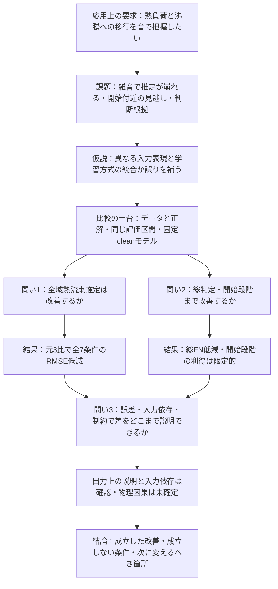

# 研究全体の流れを理解するための整理――理想・到達点・次の判断

**同日後続の本人指示を反映した現在の入口**：[最新方針に基づくまとめと実施した次工程](2026-10-23_current_research_summary_and_actions.md)。本人は最新文書を現状の基準にするよう明示し、その整理に基づく進行・要約・LaTeX修正を依頼した。三つの問いを本文へ反映済み。以下はその追加指示前の調査・説明記録であり、草稿の反映状況と次工程は後続文書を優先する。

2026-10-23。本人の「10/16の発表とその後の文書を読み、研究全体の流れと、できたこと・できていないことを深く整理してほしい」という依頼への回答。**研究の説明案であり、本人・教授が採用済みの目的や追加実行の指示ではない。** 10/21の詳細な[再検討書][reassessment]と[証拠台帳][inventory]を土台に、今回は「各結果がどうつながるか」を説明する。研究の全履歴は再掲しない。

## 1. 最初に押さえたい結論

現在の成果を一つの研究として説明する軸は、次のように置ける。

> 音響から熱負荷と沸騰への移行を把握するため、異なる表現・学習方式を持つ回帰モデルを統合する。水流音を付加した条件で熱流束推定とONB判定がどこまで改善するかを調べ、その利得と残る失敗を、誤差・入力依存・統合の制約から説明する。

この軸では、**熱流束推定の改善とONB判定の改善を、それぞれ目的への回答として扱える。** 元3モデル比の全7条件の全域RMSE・総見逃し改善は主要成果である。一方、「無雑音からの劣化を抑えた」「最初のONB段階を十分検知した」「物理的な気泡特徴によって改善した」までの証拠はそろっていない。

研究の中心材料は既にある。残る大きな仕事は、①目的と回答の対応を自分の言葉で固定すること、②データと正解の原根拠を補うこと、③追加比較のうち、どの未回答を埋めるものを採るか決めることである。修論として要求される到達範囲は指導で確認する。

## 2. 目次があっても流れが見えにくい理由

資料を照合すると、次の事情が重なっている。以下は今回の解釈で、教授の逐語発言ではない。

1. **目的の重心が文書間で異なる。** 10/19〜20と現LaTeXは開始近傍の検知を強く中心に置く。10/21は本人の意見を受け、全域回帰とONB判定を二つの主要課題に置く案へ修正した。この案は現LaTeXの目的・結言へ反映されていない。[10/19の目的照合][old-purpose]、[10/20整理][oct20]、[現緒言][intro]、[現結言][conclusions]
2. **理想の仮説が、実施すべき作業や確定した結論と混ざりやすい。** 「異なる特徴を使う→補完する→雑音耐性が上がる→開始近傍も検知できる」は、各接続を確かめる必要がある仮説である。実装・実行が済んでも、この全体が証明されたことにはならない。
3. **作業の順と論文で説明する順が異なる。** 雑音処理の診断、分割の変更、モデル追加は研究を進めた順である。論文では「解きたい問題→必要な比較→得られた回答」の順へ並べ直す。
4. **「未完了」に異なる意味がある。** 未集計、確認先からの回答待ち、既に測定された低性能、強い主張に必要な未実施検証を、一つの宿題一覧にすると終点が見えなくなる。

10/16の[教授原メモ][professor]が求めているのは、目的からの流れと、変化の理由・ロジックの説明である。目次の細分化だけでは、各章が何を答えるのかは決まらない。

## 3. 目的・問い・仮説・方法・回答を分ける

| 段階 | この研究での具体例 | 何が決まればよいか |
|---|---|---|
| 応用上の目標 | 冷却材の沸騰移行・局所異常を早く把握したい | 水の基礎検討から実機までの距離を説明する |
| 今回の研究の問い | 音響からの熱流束推定と既知ONB基準の判定を、雑音下でどこまで改善できるか | 比較相手、評価対象、改善させたい量を明示する |
| 解決の仮説 | 異なる特徴利用・誤りを持つモデルの統合が役立つ | 成立した部分と成立しない部分を結果で確かめる |
| 方法 | STFT、回帰、学習側交差予測による重み決定、固定モデルへの付加雑音、誤差・入力対照 | 選択に使う情報と評価に使う情報を区別する |
| 現在の回答 | 元3比で全域RMSE・総FNは改善、開始段階と劣化量には限界 | 成果・未達・適用範囲を同時に述べる |

「性能を評価する」だけでは、何を実現したいのかが伝わりにくい。目的は推定・判定を改善する条件を明らかにすること、その達成範囲を確かめる方法が性能評価である。回帰を使うと、連続的な熱負荷推定と、その予測値を用いた判定の関係を調べられる。ただし、回帰を経由する方式が直接分類より優れることは、現在の比較で示していない。

原計画はONB早期検知と物理的説明を強く掲げている。上の整理は、そこへ向かう問いに全域推定の価値も明示する案である。ONBを回答対象に残し、年度計画との重心の違いは教授へ説明する。[原計画の抽出][primary-plans]、[本人の理想][ideal]

## 4. 研究全体を一枚で見る

雑音は問い1・2に共通する条件である。説明性は、その性能差の理由を調べる役割を持つ。三つを別々の研究として進める必要はない。

## 5. 現在のデータで実際に測っているもの

主系列は10/15の`143609`、run hash `da540f2d`、clean fit `7560205f8feb`である。[主記録][main]、[条件][conditions]

- 2025/6/11・6/18の36録音。各60秒を1秒区間にし、各録音の45区間を学習、15区間を評価に使う。学習1620・評価540。
- 3 kHz上限。付加水流音なしで学習したモデル・前処理・重みを、無付加雑音と6つの付加雑音条件へ固定適用する。
- 熱流束の正解は録音段階の保存ラベル。ONB判定の基準は既知の日別値、6/11は221.505、6/18は271.678 kW/m²。
- 同一chunkの学習・評価重複はない。一方、元録音36本は両側で共有される。評価対象は既知録音内の未使用時間区間である。

**予測している熱流束、判定に用いる既知ONB値、真の気泡発生時刻は異なる。** 現方式は、既知のONB値を基準に回帰出力を判定する。未知条件のONB熱流束そのものを推定する検証や、最初の気泡からの検出秒数の評価は行っていない。

開始段階の30区間は、ONBに対応する録音が各日1本あり、その評価15区間ずつを合わせたもの。独立したONB実験30回ではない。±10%の近傍にも他の熱流束段階が入らないため、現在は近傍と開始段階の評価集合が一致する。各秒に実際の気泡があったという正解は未確認である。[既存の分割監査][partition]

同じ録音からの7雑音条件は対応のある負荷比較である。7回の独立実験や、未知の7雑音源への検証としては数えない。また、`reference_SNR`は共通RMS基準の付加負荷で、各区間の実現SNRと区別する。[データ仕様][dataset]

## 6. 理想の流れに対して、どこまでできたか

本人の理想は[9/15の記録][hypothesis]と[10/14の具体化][ideal]で確認した。次の各項目は、一つ前が成立すれば自動的に成立する関係ではない。

| 理想を構成する主張 | 現在の状態 | できたこと | 残ることの意味 |
|---|---|---|---|
| 比較できる入力・評価を整える | 主系列の範囲で完了 | 固定基準雑音、同一ID、固定fit、学習側の重み、保存予測の照合 | 取得者・熱流束とONBの原根拠は別に確認が必要 |
| モデルが異なる情報の使い方をする | 限定して確認 | 共通帯域加工、強度変更、時間並べ替え、34特徴の除去再学習 | 依存の差が、どの雑音利得を生んだかの単独因果は未確定 |
| 異なる誤りを統合で補える | 元3比で確認 | 同じ区間の誤差・FN訂正、領域別と符号群別の損失分解 | 最良単体・4構成に一律に勝つことや、全5モデルの必要性は示していない |
| 雑音下の絶対推定誤差を減らせる | 元3 MSE比で全6付加雑音条件に確認 | 全域RMSEと総FNを低減、FPは同数 | 未知日・独立雑音への再現性は現5で未確認 |
| 無雑音からの性能低下を抑えられる | 元3 MSE比の全域RMSEでは支持されない | 増加量の評価は完了 | 結果が仮説を支持しなかった部分。確認未実施ではない |
| 開始近傍を十分に捉えられる | 一部改善、高い検知率は未達 | 開始段階・近傍・日別到達熱流束を評価済み | clean 8/30、−20 dB 0/30という既知の限界 |
| 使った特徴を物理現象と対応づけられる | 依存は確認、音源の同定は未確定 | 2.1–2.5 kHz等への感度、時間配置依存、絶対強度と形状の併用を確認 | 対象日の原条件・独立観測を伴う物理根拠が必要 |

「全部できた」「全体として未達」のどちらか一語にまとめると、到達点を見失う。各主張の成立範囲を示すことが、現在の研究の回答になる。

## 7. 成果と理想との距離を示す主要数値

元3はRF/CNN＋Transformer/AlexNetのMSE統合、5はHGB・ExtraTreesを加えた固定ブロックMSE統合。単位はRMSEがkW/m²、FNはONB以上315区間中の見逃し数。開始段階は陽性判定数/30である。

| 条件 | 全域RMSE 元3→5 | 近傍RMSE 元3→5 | 総FN 元3→5 | 開始段階 元3→5 |
|---|---:|---:|---:|---:|
| clean | 34.07→27.80 | 39.58→16.45 | 42→27 | 3→8 |
| 0 dB | 53.12→50.27 | 55.40→64.75 | 45→44 | 3→2 |
| −4 dB | 62.76→61.95 | 77.53→82.71 | 52→45 | 2→2 |
| −8 dB | 68.12→66.66 | 99.83→99.89 | 57→47 | 0→2 |
| −12 dB | 72.37→69.01 | 115.02→113.32 | 60→48 | 0→1 |
| −16 dB | 76.14→71.51 | 116.06→112.92 | 65→50 | 0→0 |
| −20 dB | 81.14→75.23 | 93.92→99.32 | 65→52 | 0→0 |

FPは両方式ともclean 1/225、付加雑音6条件は0/225。全域回帰と総FNの改善は主要成果として述べられる。開始段階は各条件で別に評価する必要がある。例えばcleanの総Recall 91.43%と、開始段階8/30＝26.7%は、母集団が違うので同時に成立する。[主表][metrics]、[開始段階表][onset]。今回の[保存表の読取・説明用算術][audit]でも対応を確認した。

### 7.1 絶対誤差が下がっても、劣化量が小さくならない理由

元3と5の誤差差を`G(s) = RMSE元3(s) − RMSE5(s)`とする。今回の差はcleanで6.269、−20 dBで5.903である。

`元3の劣化量 − 5の劣化量 = G(雑音時) − G(clean)`

したがって、雑音時にも元3より良いだけでなく、**clean時より改善幅を大きくできた場合**に、その雑音条件で劣化量も抑えたと言える。今回は−20で改善幅が約0.366縮むため、劣化量は元3の47.067に対し5が47.433となる。全6付加雑音条件で同じ向きだった。

これは理想の仮説のうち、絶対精度の改善は支持され、増加量の抑制は元3 MSE比で支持されなかった、という明確な回答である。「雑音耐性」という語を使う際は、どの量を意味するか書く。[既存の劣化量][degradation]。比較相手を従来performance重みにすると−20端点の増加量は小さくなるが、0〜−16まで一般化できない。

### 7.2 平均誤差が下がっても、開始段階で見逃す理由

残差を`e = 予測q − 正解q`とすると、予測がONB以上になる条件は

`e + (正解q − ONB閾値) ≥ 0`

である。高熱流束側には閾値までの余裕がある。開始段階で正解q＝閾値なら、判定は残差の符号だけで決まる。例えば同じ正解に対して−1と＋1の残差は二乗誤差が等しいが、判定は逆になる。この例は判定規則の説明で、実データの残差分布を仮定していない。

さらに開始段階は全540区間中30区間で、全域MSEと境界でのFN/FPは目的が異なる。ただし「全域MSEを使ったことが全ての見逃しの原因」と断定するには、目的だけを変えた比較が必要である。予測を一律に上げるとFPも増え得る。主結果の−20 dBのRFはFN 0でもFP 217/225であり、見逃しだけを改善しても目的を満たせない。

### 7.3 現在の5統合は、予測の配分も大きく変更している

保存重みでは元3ブロック25%、HGB約27.25%、ExtraTrees約47.75%である。追加2モデルが全体の75%を占める。[保存重み][weights]

`予測5 = 0.25 × 予測元3 + 0.2725 × 予測HGB + 0.4775 × 予測ET`（後二係数は丸め）

このため成果の説明には、モデル数、入力表現、学習器、配分・下限制約を含める。ET4のclean RMSE 27.35は5の27.80より小さく、5全員が必須という結論にはならない。保持下限は比較設計上の選択で、物理法則ではない。[制約の実装][stack-code]、[制約の出所][rationale]

既存の時間並べ替え対照ではHGB/ETの特徴・予測は不変である。同じ固定重みと元3内部比率なら、構成式から

`時間並べ替えによる予測5の変化 = 0.25 × 予測元3の変化`

が各標本で成り立つ。これは既存の不変性と構成式からの**今回の代数的な説明**で、予測配列を新しく再計算した結果ではない。5の変動が小さくなる構造上の理由を説明できる。RMSE差そのものが1/4になる式ではなく、時間加工への感度低下だけで水流雑音への改善原因を確定することもできない。[共通入力対照][input-study]

### 7.4 重みを変えるだけで直る失敗か

既存の10/21監査は、元3内部比率固定・元3総量25%以上・追加各5%以上の制約下で、−20 dBの開始段階30区間は、1件ずつ最も有利な配分を与えても閾値へ届かないと確認した。[上限診断][feasibility]

これは現予測と現制約についての到達上限である。「ONB向けの重みを探索すれば強雑音の開始段階も改善するはず」という期待には根拠が弱い。cleanでの訂正可能性や、全域誤差とFN/FPの交換を調べる目的なら、限定した目的変更比較には意味がある。入力にONB情報がないことや、別の学習・制約でも不可能なことは示していない。

## 8. 「なぜ改善したか」を四段階で読む

| 説明の段階 | 現在の根拠 | そこからの回答 |
|---|---|---|
| 性能差 | 同じ評価区間のRMSE・FN/FP等 | 何をどれだけ改善し、何が残ったか |
| 出力の仕組み | 領域・残差方向・訂正/追加・配分・制約 | どの予測調整が損失差を作ったか |
| 入力への依存 | 共通加工、34→5/29特徴の除去再学習 | 現在のモデルがどの情報に依存するか |
| 物理的な機構 | 対象日の原条件、観察、物理研究との対応 | その情報が何の現象に由来し、性能差を生んだか |

前の三段階に成果がある。最後の段階には未確認が残る。

元3/HGB/ETの3ブロックが同じ方向へ外れた標本でも、誤差の小さい予測へ動けば元3より改善できる。逆符号の相殺は必要条件ではない。−20 dBのMSE減少の87.15%は同方向群から生じたが、これは標本群別の損失の内訳である。「物理的特徴の違いが改善の87.15%を引き起こした」という因果割合ではない。[誤差接続][linkage]、[主系列の方向別表][directions]

34特徴には時間powerの変動係数がある。時間変動の大きさを含み、秒内の順序は保存しない。10/16スライド8の「時間に関する特徴はない」は、この区別で理解・修正する必要がある。[特徴の定義][feature-code]

2.1–2.5 kHz減衰で5のclean RMSEが27.80→117.28と大きく悪化したこと、全34併用が絶対power5・相対形状等29だけより回帰で良いことは、モデル依存を支える。一方、人工加工で入力分布が変わる可能性があり、気泡・細線・伝達経路のいずれを捉えたかは特定できない。[入力対照][input-study]

IGも、指定した基準入力と実入力の間の出力差を説明する方法である。物理音源を直接同定する測定とは役割が異なる。[IG原論文](https://proceedings.mlr.press/v70/sundararajan17a.html)。既存の共通入力対照と誤差分析を性能差へ接続することが、現在の中心説明になる。

## 9. 「できていない」を、対応が違う四種類へ分ける

| 種類 | 該当するもの | 次の対応 |
|---|---|---|
| 結果として分かった限界 | 開始段階の低検知、元3 MSE比の劣化量非改善、5の非一律優位 | 結論へ記す。改善研究を採るか別に判断する |
| 今の主張の土台にある確認不足 | 取得者・提供元、熱流束算出、ONBの原観察根拠、対象日条件 | 資料・担当者へ確認する。計算の追加では埋まらない |
| 説明・原稿への反映不足 | 10/21の重心と現緒言・結言のずれ、理由と結果の接続、先行研究比較 | 目的・問い・回答と引用を対応させて改訂する |
| 追加の問いとして未実施 | CNN3の外側比較、ONB目的統合、現5の未知日検証、独立雑音・同期観測 | 主張に必要なものだけ採る。全てを完成条件にしない |

CNN3について、本調査で参照した最新の保存監査は**10/22 13:55 JST時点**のAlexNet36/36・ResNet50 36/36・VGG16 1/36。ResNet50は同日14:12の記録でlr=0.0001・batch32へ固定されている。全て学習側交差予測での探索・選択の話で、外側の主性能比較の完成とは異なる。10/23現在の稼働・候補数は今回再監視していない。[保存監査][cnn-status]、[ResNet選択][resnet]

CNN3は「調整したCNN系構成でも同様の成績が得られるか」を補う。表現、容量、学習方式等も同時に変わるため、「異種性だけの因果効果」の証明にはならない。良否にかかわらず、記録した調整範囲内の構成対照として使う。

既存のmatched/clean_only、雑音生成診断、q100定義照合、時間加工、特徴除去、比率自由化、入力と配分の分解、保存予測検算は完了扱いを維持する。[証拠台帳][inventory]。古い文書に「次に行う」とあるだけで未実施へ戻さない。

## 10. 6章の目次を、研究の説明に変える

10/16修正版の実ファイルは14枚・SHA256 `7258779c…`。スライド13の[目次画像左][outline-left]・[右][outline-right]も原ファイルから確認した。6章の大枠は流れを組める。第2章は発表時の「プール沸騰実験と音響データ」から、発表後の[案][outline]で「使用データと解析条件」へ修正されている。

| 章 | 読者がここで理解すること | 章末から次章へ渡す一文の案 |
|---|---|---|
| 1 緒言 | なぜ熱流束推定・ONB判定・説明が必要か | 「このため、両性能と改善理由を同じデータで検証する。」 |
| 2 使用データと解析条件 | 他者取得データの出典、ラベル、判定基準、回答できる対象 | 「このデータの範囲で、次の方法による比較を行う。」 |
| 3 手法 | 各モデルの入力、重み選択、付加負荷、三つの問いの評価方法 | 「以上の規則で推定と判定を分けて評価する。」 |
| 4 性能評価 | 全域・雑音・総判定・開始段階の改善と交換 | 「全域・総判定の利得が開始段階へ一律に及ばないため、その所在を分析する。」 |
| 5 要因分析・考察 | 出力・入力・制約から説明できることと物理解釈の限界 | 「現構成の利得と限界から、設計上の判断を導く。」 |
| 6 結言 | 三つの問いへの回答、適用範囲、残る課題 | 研究目的に対応した成果と未達を述べる |

第4章の結果を説明するために第5章を使う。例えば「−20で全域は改善し近傍は悪化」→「領域の損失分解」→「現在の入力依存と配分」→「開始段階が重みだけで直らない範囲」という接続である。第5章を説明画像の一覧にすると、この関係が弱くなる。

## 11. 外部の一次資料から見た研究の位置づけ

今回、既存草稿の文献と、近い研究室関連論文を確認した。以下は比較の着眼点であり、先行研究全体を網羅した新規性証明ではない。出版社本文へ取得制約があるものは、要旨・公開検索表示までの確認とした。

| 一次資料・確認範囲 | 確認した内容 | 今回の論文への意味 |
|---|---|---|
| [Dunlapら、2023](https://www.sciencedirect.com/science/article/abs/pii/S1359431123005872)／出版社要旨・公開表示 | 水中音響から熱流束を回帰し、入力長・低周波情報も検討 | 熱流束回帰の価値には既往の裏付けがある。回帰の実施だけを独自性にしない |
| [Barathulaら、2023](https://www.sciencedirect.com/science/article/abs/pii/S0017931022010924)／出版社要旨 | 音響から未沸騰・核沸騰・CHFの状態分類を比較 | 状態分類の高精度と、開始段階を少ないFN/FPで捉えることの評価を区別する |
| [Uekiら、2025](https://doi.org/10.1016/j.aitf.2025.100021)／出版社要旨・公開検索表示、[JAEA書誌](https://jopss.jaea.go.jp/search/servlet/search?5086358=&language=1) | 同研究領域でCNN分類、Grad-CAM、熱流束回帰が既にある。公開表示では開始近傍の微弱・間欠的な音とラベル付けの難しさも述べる | 「回帰＋ONB＋説明画像」の存在だけでは今回の追加知見が伝わらない。境界評価・統合の利得と失敗・理由を比較軸にする |
| [植木、2026](https://www.jstage.jst.go.jp/article/jjmf/40/2/40_2026.T010/_article/-char/ja)／J-STAGE書誌・抄録。PDF本文は取得できず | 高速炉での沸騰把握を最終目標に、水の音響・CNN・可視化・回帰の基礎検討を位置づける | 応用上の目標と今回実証する範囲を分ける説明の参考になる |
| [Huangら、2026](https://www.nature.com/articles/s41598-026-41757-z)／公開本文、特にAcoustic signal regression・Noise interference | サブクール流動沸騰のSTFT/CNN回帰、白色雑音と運転条件変化の評価 | 雑音評価自体にも既往がある。プール沸騰・固定基準水流音・統合・ONB境界の関係を具体的に述べる |

Uekiら2025と植木2026は、現在の[草稿参考文献][references]には掲載されていない。優先して本文の条件・分割・開始段階の扱いを照合し、関連研究の軸に加える候補となる。類似装置や同研究室の著者名から、2025/6/11・6/18のデータ取得者を推定してはいけない。

Dunlapらの低周波に関する結果と、こちらの2 kHz近辺の依存は、装置・対象・前処理の違う観測である。こちらは500 Hz高域通過を含む。一般に有効な唯一の帯域を、この比較から選ぶことはできない。[現データ仕様][dataset]

現時点の**貢献の候補**は、「対象を明示した水流音負荷に対し、統合の全域推定・ONB判定の利得と境界での限界を同じ予測で示し、誤差・情報保持・配分制約を対応させて設計上の知見を得たこと」である。世界初や手法一般の優位を意味するものではなく、文献本文との比較で表現を絞る。

## 12. 次に進む順序と、各段階の終了条件

### 12.1 まず、目的と三つの回答を一枚に固定する

本書の中心部分を次の三問で読めれば、研究の流れが見えているかを確認できる。

1. **推定は改善したか。** 元3 MSE比で全7条件の全域RMSEを低減した。全構成への一律優位・劣化量抑制は示していない。
2. **判定も改善したか。** 総FNは減少しFPは同数だった。開始段階は限定改善で、高い検知率は得られていない。
3. **なぜ、どこまで説明できるか。** 誤差群・入力依存・固定配分と上限から説明できる。物理音源と改善原因の一意な対応は未確定。

**終了条件**：目的、三問の回答、根拠図表、残る限界をそれぞれ一つずつ指せる。第1章と第6章に同じ三問が現れる。これは自分の理解と指導相談の基準で、研究目的の採用を本書で代行しない。

### 12.2 並行して、原データと正解の確認を進める

優先対象は主2日の取得者・提供元・熱流束算出・原ONB判定。雑音音源の来歴と、共通RMSに7/9を含むことも明示する。採用数値の確認と原観察の確認は区別する。詳細は[10/21確認表][reassessment]第7.1節にある。

教授・管理者へ伝える内容の案：

> 2025年6/11・6/18の既存音響データを解析しています。データ取得・収録の実施者と提供経路、熱流束ラベルの算出資料、日別ONB値を決めた観察・判定資料を確認したいです。私は当日の実験・収録には参加していないため、原ノートと確認すべき担当者を教えていただきたいです。秒単位の気泡発生時刻を確認できる記録の有無も知りたいです。

**終了条件**：確認できた事項は資料へ結び、不明な事項は主張に与える制限とともに記す。回答待ちの間も、方法・主結果・既存考察の文章化を進める。上記の依頼を外部へ送信したわけではない。

### 12.3 既存の第4・5章を、三つ程度の図群で接続する

| 図群 | 示すもの | 読者に残す回答 |
|---|---|---|
| 全域RMSEと雑音負荷 | 元3・4・5・主要単体、絶対誤差とclean差 | 全域推定はどの比較で改善したか |
| 総FN/FPと開始段階 | 母数315/225/30、日別q100を補助 | 総判定の利得が開始段階へ一律には及ばない |
| 誤差分解と入力対照 | 非重複領域、方向群、共通加工・除去、固定重み | 利得と失敗をどの水準まで説明できるか |

既存図表を使って主張との対応を整える。図の新規大量作成を終了条件にしない。原論文の条件と自分の実証範囲を比較する表も、この段階で補う。

### 12.4 追加研究は、答えを変えるものを選ぶ

| 補いたい回答 | 候補と実施する理由 | 採る場合の終了条件 |
|---|---|---|
| 構成選択の根拠 | 既に進めているCNN3の選択固定・同じIDでの外側比較 | 調整履歴を明示して全域・判定・負荷を一括比較。良い順位を得るまで探索を増やさない |
| 最適化目的と判定の交換 | 保存学習側OOFで目的を一つだけ変える限定対照 | 基礎予測・制約を固定しFN/FP・回帰の交換を報告。−20開始層救済を現制約の目標にしない |
| 未知条件にも通用するという主張 | 現5の適切な未知WAV/未知日・独立雑音評価 | 開発参照履歴を含め評価範囲を設計。主張する場合に必要性を相談する |
| 気泡現象が原因だという主張 | 対象条件の確認と独立観測・条件対照 | 帰属画像だけで結論しない。必要設備・資料の可否から判断する |

この順序は追加実行の採用指示ではない。現5の未知日評価、新2026データの主系列追加、停止matchedの再解析、広い新モデル探索を今回自動追加しない。

時期の案は、**10月末に目的・三問・章の役割を仮固定、11月上旬に必要な補強を選び、11月末に主結果をまとめ、12月に本文統合と指導修正**とする。本人の12月末、遅くとも1月前半の本文完成希望に合わせた提案で、正式提出日や教授了承済み日程ではない。[本人の時間軸][schedule]

## 13. 教授へ相談する際の焦点

原計画の開始近傍・物理対応を残しながら、次の三点を相談する。

1. 全域熱流束推定とONB判定を主要な二課題とし、改善条件と限界を説明する構成でよいか。
2. 現在の既知録音内の比較を中核に置けるか、現5の未知条件評価まで必要か。
3. 開始段階の未達に対し、CNN構成比較・目的変更比較・物理的根拠確認のどれを優先すべきか。

相談時の文章案：

> 異なる表現のモデル統合により、対象の全7条件で元3より熱流束の全域誤差と総見逃しを減らせました。一方、開始段階はclean 8/30、−20 dB 0/30で、無雑音からの誤差増加量も元3 MSEより抑えていません。誤差分解と入力対照から改善の内訳と依存差は説明できますが、物理因果と未知条件での再現性は未確定です。この利得と限界を、全域推定・ONB判定・改善理由の三つの問いでまとめたいと考えています。修論で補うべき最小の根拠と、データ出典・ONB原判定の確認先を相談したいです。

## 14. 研究を一分で説明する文章案

> 私の研究は、沸騰音から熱流束と沸騰への移行を把握するために、複数の回帰モデルをどう組み合わせると、雑音下の推定と判定を改善できるかを調べるものです。まず、同じ学習済みモデルへ水流音を付加して比較する評価を整えました。次に、スペクトログラムを使うモデルに音響の要約特徴を使うモデルを加え、対象の全7条件で元の3モデルより全域誤差と総見逃しを減らしました。ただし、最初のONB段階の検知や、雑音による誤差増加量は同じようには改善しませんでした。そこで、どの領域の誤差が縮み、どの情報に依存し、どの失敗が現在の重みでは直らないかを分析しました。これらから、統合の利得と開始近傍での限界を示し、入力・統合目的・制約を対応づけた設計上の知見を得ることを目指しています。現在はデータの原根拠と関連研究を補い、必要な構成比較を選んで論文の回答を固める段階です。

これは現時点の説明案で、未知日・実機・気泡発生秒の検証まで行ったという意味を含めない。

## 確認範囲

10/16修正版PPTXの全スライドのXML本文と目次画像、教授原メモ、原計画の保存抽出、9/15・10/14本人方針、10/19〜21の目的・章論理・優先度・証拠台帳、現LaTeXの目的・手法・考察・結言・不足一覧・参考文献、10/15の主解析と保存主表、10/7入力対照、10/21既存監査、10/22 CNN保存監査・選択記録、上記の一次文献を必要範囲で確認した。

今回は保存集計表の読取と説明用算術、PPTX本文・画像抽出を行った。主予測の全面再検算・新学習・推論・入力加工・CNNの監視や操作・原スライド/草稿/通常設定の変更は行っていない。[確認記録][audit-readme]

[reassessment]: 2026-10-21_research_logic_reassessment_user_feedback.md
[inventory]: 2026-10-21_research_activity_evidence_inventory.md
[old-purpose]: ../thesis/2026-10-19_research_purpose_revision_and_alignment.md
[oct20]: 2026-10-20_october_research_logic_and_priorities.md
[intro]: ../../LaTeX/master_thesis/chapters/01_introduction.tex
[conclusions]: ../../LaTeX/master_thesis/chapters/06_conclusions.tex
[professor]: 2026-10-16_after_presentation_professor_discussion.md
[primary-plans]: ../../experiments/2026-10-21_research_logic_audit/primary_document_extracts.md
[ideal]: 2026-10-14_ideal_conclusion_and_friday_issue_list.md
[hypothesis]: 2026-09-15_master_thesis_hypothesis.md
[main]: ../../experiments/2026-10-15_clean_only_result_analysis/README.md
[conditions]: ../../experiments/2026-10-15_clean_only_result_analysis/conditions.json
[partition]: ../../experiments/2026-10-21_research_logic_audit/onb_stage_partition.csv
[dataset]: ../../configs/datasets/waterflow_20260817_1s.yaml
[metrics]: ../../experiments/2026-10-15_clean_only_result_analysis/pooled_metrics.csv
[onset]: ../../experiments/2026-10-15_clean_only_result_analysis/recorded_onb_point_detection.csv
[degradation]: ../../experiments/2026-10-15_clean_only_result_analysis/noise_degradation.csv
[weights]: ../../experiments/2026-10-15_clean_only_result_analysis/weights.csv
[stack-code]: ../../code/utils/ensemble/fixed_core_stacking.py
[feature-code]: ../../code/utils/dataloading/acoustic_summary_features.py
[rationale]: ../notes/2026-10-06_five_model_rationale_and_next_steps.md
[input-study]: ../../experiments/2026-10-07_onb_input_and_integration/README.md
[feasibility]: ../../experiments/2026-10-21_research_logic_audit/onb_failure_feasibility.csv
[linkage]: ../../experiments/2026-10-14_error_feature_linkage/README.md
[directions]: ../../experiments/2026-10-15_clean_only_result_analysis/error_direction_contributions.csv
[cnn-status]: ../../experiments/2026-10-22_cnn_three_tuning_progress/status_135525.json
[resnet]: ../../experiments/2026-10-22_resnet50_parameter_selection/selection.json
[outline]: 2026-10-16_unified_six_chapter_thesis_outline.md
[outline-left]: ../../experiments/2026-10-23_research_story_audit/slide13_outline_1.png
[outline-right]: ../../experiments/2026-10-23_research_story_audit/slide13_outline_2.png
[references]: ../../LaTeX/master_thesis/references.tex
[schedule]: 2026-10-19_research_to_manuscript_december_schedule.md
[audit]: ../../experiments/2026-10-23_research_story_audit/evidence.json
[audit-readme]: ../../experiments/2026-10-23_research_story_audit/README.md
